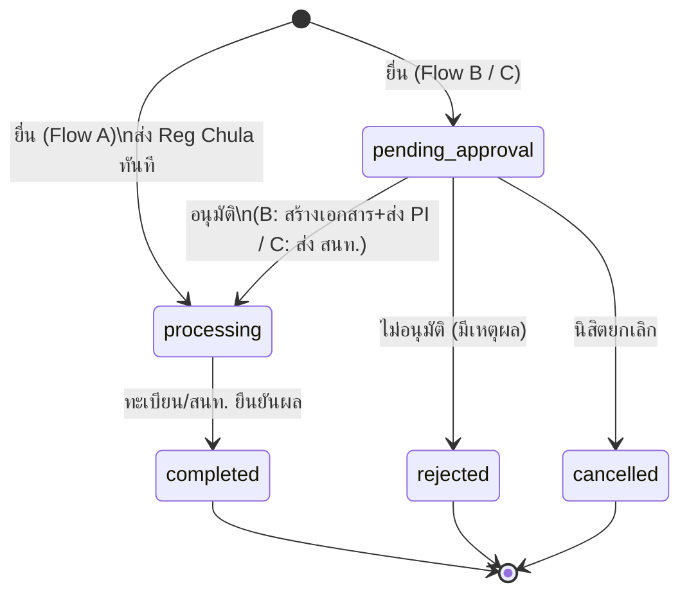
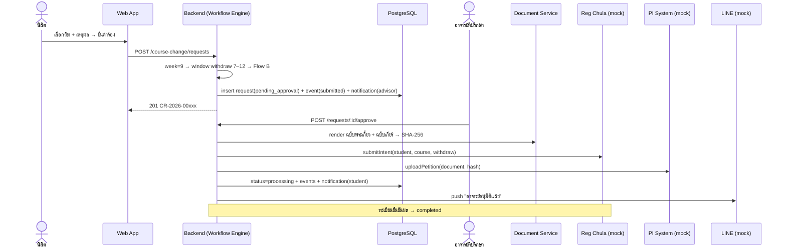

# Auto Drop/Withdrawal Portal — Design Spec (v0.1)

> **รุ่นใหม่ 4/11/2569:** คำร้อง HTTP ใหม่ใช้ workflow version 2 และกำหนดรายวิชา/Section ดู [ผลพัฒนาและพฤติกรรมปัจจุบัน](IMPLEMENTATION-2026-11-04.md) spec v0.1 ด้านล่างยังใช้กับข้อมูลประวัติ version 1 ไม่ใช่เงื่อนไขครบถ้วนของคำร้องใหม่

> ระบบลด/ถอนรายวิชาแบบ Single Portal ต่อยอดจาก CEDT LabSync (`prototype-1/`)
> เอกสารนี้คือ spec ที่ใช้ implement จริง — ทุก business rule มีรหัส `CC-BR-x` ที่อ้างถึงได้จากโค้ดและเทสต์

> **อัปเดต 28/10:** routing matrix และเอกสารในเอกสารนี้เป็นข้อตกลงของเดโม iteration 1 ยังไม่ใช่ flow ที่เจ้าหน้าที่รับรอง โดยเฉพาะ Block 1–7 และวิชาเลือกภาคปลาย ดูข้อเท็จจริงและสิ่งที่รอใน [rport 28/10](rport-28-10.md) และ [ชุดทดลอง](UAT-28-10.md) การสร้างเอกสารและส่งปลายทางที่กล่าวถึงด้านล่างยังเป็นตัวอย่าง/การจำลอง

---

## 0. สถานะงาน (สรุปสำหรับอาจารย์)

| ขั้น | งาน | สถานะ |
|---|---|---|
| 1 | วิเคราะห์กระบวนการเดิม + pain points | ✅ เสร็จ (โจทย์) |
| 2 | Figma: หน้า Student / Staff | ✅ เสร็จ (wireframe) |
| 3 | **Design spec** — routing matrix, business rules, state machine, data model, API contract (เอกสารนี้) | ✅ เสร็จ |
| 4 | **Backend** — schema + migration, workflow engine, API, mock integrations, document generator | ✅ เสร็จ (prototype) |
| 5 | **Frontend** — หน้า Student / Staff ตาม Figma ต่อกับ API จริง | ✅ เสร็จ (prototype) |
| 6 | **Tests** — unit (timeline/routing) + integration (flow A/B/C, สิทธิ์, deadline) | ✅ เสร็จ |
| 7 | เชื่อมระบบจริง (Chula SSO, Reg Chula, PI, LINE) | ⏳ รอสิทธิ์/ข้อมูล API จากมหาวิทยาลัย — ใช้ mock adapter แทน |
| 8 | PDF จริง + ลายเซ็นดิจิทัลตามมาตรฐาน (PAdES) | ⏳ รอบถัดไป — ตอนนี้เป็นเอกสาร HTML พิมพ์ได้ + SHA-256 |
| 9 | Admin Panel (ตั้งค่าสัปดาห์ / รายวิชาที่เปิดให้ลด-ถอน ผ่าน UI) | ✅ เสร็จ (prototype): preview, validation, audit และป้องกัน stale edits |
| 10 | Usability test กับนิสิต + เจ้าหน้าที่ | ⏳ ยังไม่เริ่ม |

**ผลการทดสอบล่าสุด (28 ต.ค. 2569):** Course Change 71/71; backend ทั้งหมด 84/84 บนฐานทดสอบใหม่ และ frontend 31/31 รวมการกู้คืนฉบับร่าง การลองยื่นเดิมแบบไม่ซ้ำ และการล้าง session cache ดู [rport 28/10](rport-28-10.md)

**ไฟล์หลัก:** backend `prototype-1/backend/src/modules/course-change/` · migration `prisma/migrations/20261002120000_course_change/` · frontend `prototype-1/frontend/src/features/course-change/` · tests `prototype-1/backend/test/course-change-*.test.ts`

---

## 1. ขอบเขตของรอบนี้ (Iteration 1)

**ทำ (in scope)** — vertical slice ที่รันได้จริงตั้งแต่ต้นจนจบ

- นิสิตเห็นสัปดาห์ปัจจุบัน + ช่วงเวลาที่ลด/ถอนได้ + เส้นทางอนุมัติที่จะเกิดขึ้น **ก่อน** ยื่น
- นิสิตเลือกวิชา (จากวิชาที่ลงทะเบียน ∩ วิชาที่หลักสูตรประกาศให้ลด/ถอน) แล้วยื่นคำร้อง
- ระบบเลือก Flow A/B/C อัตโนมัติจากสัปดาห์ (Smart Timeline Detection) และปิดรับเมื่อหมดเวลา (Deadline Enforcer)
- เจ้าหน้าที่/อาจารย์อนุมัติ, ไม่อนุมัติ (ต้องมีเหตุผล), อนุมัติหลายรายการพร้อมกัน (bulk)
- Flow B: อนุมัติแล้วระบบสร้างเอกสารคำร้องรวม (ฉบับพระเกี้ยว + ฉบับเกียร์) พร้อม signature block + hash ให้อัตโนมัติ
- ติดตามสถานะแบบ step-by-step + audit log ทุกการเปลี่ยนสถานะ
- แจ้งเตือนในระบบ (กระดิ่ง) + ส่ง LINE ผ่าน mock adapter

**ยังไม่ทำ** — Chula SSO จริง, Reg Chula / PI API จริง, PDF จริง + PKI, LINE LIFF และนโยบายที่รอยืนยันจากผู้ใช้งานจริง

---

## 2. ผู้ใช้ (Actors)

| Actor | role ในระบบ | ทำอะไรได้ |
|---|---|---|
| นิสิต | `student` | ดูช่วงเวลา, ยื่นคำร้อง, ติดตามสถานะ, ยกเลิกคำร้องที่ยังรออนุมัติ, เปิดเอกสาร |
| อาจารย์ที่ปรึกษา / เจ้าหน้าที่หลักสูตร | `staff` | ดูคำร้องทั้งหมด, อนุมัติ/ไม่อนุมัติ/bulk, บันทึกผลจากทะเบียน |
| ระบบภายนอก | — | Reg Chula, PI, LINE (ผ่าน Integration Layer) |

> นิสิตแต่ละคนมี `advisorId` — Flow B แจ้งเตือนอาจารย์ที่ปรึกษาของนิสิตคนนั้น, Flow C แจ้งเตือนเจ้าหน้าที่หลักสูตรทุกคน

---

## 3. Smart Timeline Detection — Routing Matrix

สัปดาห์คำนวณจากวันเปิดภาคของเทอมที่ active: `week = floor((today − term.startDate) / 7) + 1`

| ประเภท | สัปดาห์ | Flow | ขั้นตอน |
|---|---|---|---|
| ลด (`drop`) | 1–6 | **A** `reg_direct` | ส่ง Reg Chula ทันที → ทะเบียนยืนยันผล |
| ลด (`drop`) | 7–18 | **C** `program_registrar` | หลักสูตรอนุมัติ → รวบรวมส่ง สนท. → สนท. แจ้งผล |
| ถอน (`withdraw`) | 1–2 | — | **ปิด** (ยังไม่เปิดให้ถอน) |
| ถอน (`withdraw`) | 3–6 | **A** `reg_direct` | ส่ง Reg Chula ทันที → ทะเบียนยืนยันผล |
| ถอน (`withdraw`) | 7–12 | **B** `advisor_pi` | อาจารย์อนุมัติ → สร้าง+รวมเอกสาร + ลายเซ็นดิจิทัล → ส่ง Reg Chula + PI → ทะเบียนยืนยันผล |
| ถอน (`withdraw`) | 13–18 | **C** `program_registrar` | หลักสูตรอนุมัติ → รวบรวมส่ง สนท. → สนท. แจ้งผล |

ตารางนี้เก็บใน DB (`course_change_windows`, ต่อเทอม) ไม่ hard-code — staff แก้ผ่านหน้าตั้งค่าได้ โดยระบบตรวจช่วงทับซ้อน เก็บค่าก่อน/หลัง ผู้แก้ไข และเหตุผลใน `course_change_settings_events` คำร้องที่ยื่นแล้วคง flow เดิม

```mermaid
gantt
  dateFormat  X
  axisFormat  W%s
  section ลดรายวิชา
  A ส่ง Reg Chula      : 1, 7
  C ผ่านหลักสูตร→สนท.  : 7, 19
  section ถอนรายวิชา
  A ส่ง Reg Chula      : 3, 7
  B อาจารย์→PDF→PI     : 7, 13
  C ผ่านหลักสูตร→สนท.  : 13, 19
```



---

## 4. Business Rules

| รหัส | กฎ | บังคับที่ |
|---|---|---|
| CC-BR-1 | ยื่นได้เฉพาะวิชาที่นิสิต **ลงทะเบียน** ในเทอมที่ active **และ** อยู่ในรายชื่อวิชาที่หลักสูตรประกาศให้ลด/ถอนประเภทนั้น (Centralized Announcement) | service |
| CC-BR-2 | หนึ่งวิชามีคำร้องที่ยังมีผล (`pending_approval` / `processing` / `completed`) ได้ไม่เกิน 1 รายการต่อเทอม | **DB** (partial unique index) + service |
| CC-BR-3 | Flow ถูกตัดสินที่ **server** ตอนยื่น จากวันที่ปัจจุบัน — ค่าที่หน้าเว็บแสดงเป็นแค่ preview; `flow` และ `weekNo` ถูก snapshot ลงคำร้อง ไม่เปลี่ยนแม้นโยบายเปลี่ยนภายหลัง | service |
| CC-BR-4 | ถ้าไม่มี window ที่เปิดสำหรับประเภทนั้นในสัปดาห์นี้ → ปฏิเสธ (`422 WINDOW_CLOSED`) — Deadline Enforcer | service |
| CC-BR-5 | นิสิตยกเลิกได้เฉพาะคำร้องของตัวเองที่ยัง `pending_approval` | service |
| CC-BR-6 | อนุมัติ/ไม่อนุมัติได้เฉพาะ `pending_approval`; ไม่อนุมัติต้องมีเหตุผล | service + zod |
| CC-BR-7 | Flow B: เมื่ออนุมัติ ระบบสร้างเอกสารรวม + hash, ส่ง Reg Chula (แสดงความจำนง) และ PI อัตโนมัติ — นิสิตไม่ต้องพิมพ์/เซ็น/สแกน/รวมไฟล์เอง | service |
| CC-BR-8 | ผลสุดท้ายจากทะเบียน (`processing → completed`) บันทึกโดย staff ในรอบนี้ — production แทนด้วย webhook/polling จาก Reg Chula | service |
| CC-BR-9 | ทุกการเปลี่ยนสถานะเขียน audit event + notification **ใน transaction เดียวกัน** | service |
| CC-BR-10 | นิสิตเห็นเฉพาะคำร้องของตัวเอง; staff เห็นทั้งหมด; นิสิตเข้า API ฝั่ง staff ไม่ได้ (403) | auth plugin |
| CC-BR-11 | รายวิชาที่ยื่นได้ต้องอยู่ในรายการรายวิชา CEDT (`courses.catalog_source`) และยังเปิดใช้งาน (`is_active`) — เพิ่มใน DATA-001, ดู [DATABASE.md](DATABASE.md) | service |

---

## 5. State Machine



Audit event types: `submitted`, `approved`, `rejected`, `cancelled`, `document_generated`, `sent_to_reg_chula`, `sent_to_pi`, `forwarded_to_registrar`, `completed`

---

## 6. Sequence — Flow B (ถอนสัปดาห์ 7–12)



---

## 7. Data Model

```mermaid
erDiagram
  users ||--o{ enrollments : "ลงทะเบียน"
  users ||--o{ course_change_requests : "ยื่น"
  users |o--o{ users : "advisor"
  terms ||--o{ course_change_windows : "ช่วงเวลา"
  terms ||--o{ allowed_courses : "ประกาศ"
  courses ||--o{ enrollments : ""
  courses ||--o{ allowed_courses : ""
  courses ||--o{ course_change_requests : ""
  course_change_requests ||--o{ course_change_events : "audit"
  course_change_requests ||--o{ notifications : ""

  course_change_windows { uuid term_id; enum request_type; int week_from; int week_to; enum flow }
  allowed_courses { uuid term_id; uuid course_id; bool allow_drop; bool allow_withdraw; text note }
  enrollments { uuid student_id; uuid term_id; uuid course_id; text section; int credits }
  course_change_requests { text request_no; enum request_type; enum flow; int week_no; enum status; text reason; text document_hash; text reg_chula_ref; text pi_ref; jsonb snapshot }
  course_change_events { bigint id; uuid actor_id; enum event_type; text note; jsonb payload }
```

ตารางตามโจทย์ ↔ ตารางจริง: `Users` → `users` (+`student_no`, `advisor_id`, role `student`), `Academic_Calendar` → `terms` + `course_change_windows`, `Allowed_Courses` → `allowed_courses`, `Requests` → `course_change_requests`, `Audit_Logs` → `course_change_events`

เลขคำร้อง `CR-<ปี>-<5 หลัก>` มาจาก Postgres sequence (เหมือน `LS-…` ของ booking)

---

## 8. API Contract (`/api/v1`)

| Method | Path | สิทธิ์ | คำอธิบาย |
|---|---|---|---|
| GET | `/course-change/context` | student, staff | วันนี้, สัปดาห์, เทอม, windows ทั้งหมด, flow ที่เปิดอยู่ตอนนี้ของแต่ละประเภท + วันปิดรับ |
| GET | `/course-change/settings` | staff | ช่วงเวลา/ประกาศรายวิชา, revision และประวัติการตั้งค่า |
| POST | `/course-change/settings` | staff | บันทึก windows/courses พร้อม reason และ revision เพื่อป้องกัน stale update |
| GET | `/course-change/eligible-courses?type=drop\|withdraw` | student | วิชาที่ลงทะเบียน + `eligible` + เหตุผลถ้ายื่นไม่ได้ |
| POST | `/course-change/requests` | student | `{ clientRequestId?, requestType, courseId, reason, routePreview? }` → 201; frontend ส่ง UUID เดิมเมื่อลองยื่นข้อมูลเดิมซ้ำ |
| GET | `/course-change/submissions/:id` | student | ค้นผลด้วย clientRequestId เฉพาะของตัวเอง → request หรือ null; ไม่สร้างคำร้อง |
| GET | `/course-change/requests?status=&type=&search=&page=&pageSize=&courseId=&termId=` | student (ของตัวเอง), staff (ทั้งหมด) | list + counts + pagination; status=done รวม completed/rejected/cancelled |
| GET | `/course-change/request-groups?status=&type=&search=` | staff | จำนวนคำร้องรวมตามวิชา/เทอมจากผลทั้งหมดที่ตรงตัวกรอง |
| GET | `/course-change/requests/:id` | เจ้าของ, staff | รายละเอียด + `steps[]` + `events[]` |
| POST | `/course-change/requests/:id/cancel` | เจ้าของ | CC-BR-5 |
| POST | `/course-change/requests/:id/approve` | staff | CC-BR-6/7 |
| POST | `/course-change/requests/bulk-approve` | staff | `{ ids[] }` → ผลรายตัว (สำเร็จ/ล้มเหลว) |
| POST | `/course-change/requests/:id/reject` | staff | `{ reason }` |
| POST | `/course-change/requests/:id/complete` | staff | CC-BR-8 |
| GET | `/course-change/requests/:id/document` | เจ้าของ, staff | เอกสารคำร้องรวม (HTML พิมพ์ได้) |

Error envelope เดียวกับระบบเดิม: `{ error: { code, message, details } }`

การยื่นที่มี clientRequestId ใช้ transaction lock และ unique(studentId, clientRequestId) เพื่อให้การยืนยันพร้อมกันหรือการลองใหม่คืนคำร้องเดิม ไม่สร้าง audit/notification ซ้ำ แม้คำร้องเดิมยกเลิกแล้วหรือเวลารับคำร้องผ่านไปแล้ว หากใช้รหัสเดิมกับเนื้อหาที่แก้ไขจะได้ 409 คำร้องใหม่ต้องใช้รหัสใหม่และผ่านกฎรายวิชา/ช่วงเวลาเดิมทั้งหมด

---

## 9. Integration Layer

ทุกระบบภายนอกอยู่หลัง interface เดียว (`src/modules/course-change/integrations.ts`) — รอบนี้เป็น **mock** ที่คืน reference number และ log การเรียก เมื่อได้ API จริงเปลี่ยนแค่ implementation ไม่กระทบ workflow

| Adapter | Method | Production |
|---|---|---|
| `regChula` | `submitIntent()` | Reg Chula API (ต้องขอสิทธิ์ สนท.) |
| `piSystem` | `uploadPetition()` | PI System API ของคณะ |
| `line` | `push()` | LINE Messaging API (ต้องผูก LINE userId ผ่าน LIFF) |
| SSO | — | Chula SSO แทน login form เดิม |

> ข้อควรระวังสำหรับ production: การเรียกระบบภายนอกควรย้ายออกจาก DB transaction ไปใช้ **outbox pattern** + retry; รอบนี้ mock เป็น in-process จึงยังเรียกใน transaction ได้

---

## 10. UI ↔ Figma

| Figma | Implementation |
|---|---|
| Header: `CEDT LabSync` + dropdown `Course Change` | เมนู `Course Change → ลด / ถอนรายวิชา` (`/course-change`) |
| Student: การ์ด "ประเภทคำร้อง" + "ยื่นได้ถึง …" + ปุ่ม "ยื่นคำร้อง" | สลับ ลด/ถอน, แสดงสัปดาห์ + flow + วันปิดรับ, ปุ่มถูกล็อกเมื่อปิดรับ |
| Student: "Forms / cards / navigation" | Timeline สัปดาห์ 1–18, การ์ดเลือกวิชา, เหตุผล, preview เส้นทางอนุมัติ |
| Student: ตาราง Request ID / ประเภท / รายวิชา / สถานะล่าสุด / action | ตารางคำร้อง + dialog ติดตามสถานะ (step tracker + audit log) |
| Staff: "List of contents" | Inbox แยกตามสถานะ + checkbox สำหรับ bulk approve |
| Staff: "Display Selected content" | รายละเอียดนิสิต/วิชา/เหตุผล, step tracker, เอกสาร, ปุ่มอนุมัติ/ไม่อนุมัติ/บันทึกผล |

Design system เดิม: monochrome, สถานะแสดงด้วย texture (solid / dashed / outline) ไม่ใช้สีแดง-เขียว

---

## 11. Test Plan

- **Unit** — `weekOf`, `resolveWindow` ทุกขอบของ routing matrix (สัปดาห์ 0, 1, 2, 3, 6, 7, 12, 13, 18, 19)
- **Integration** (Fastify inject + Postgres จริง)
  - Flow B: ยื่น → อาจารย์อนุมัติ → มีเอกสาร + hash + ref ของ Reg Chula/PI → บันทึกผล → completed
  - Flow C: ยื่นลดสัปดาห์ 9 → pending → reject ต้องมีเหตุผล
  - CC-BR-2 ยื่นซ้ำวิชาเดิม → 409; CC-BR-1 วิชาที่ไม่ได้ลงทะเบียน → 422
  - CC-BR-10 นิสิตเรียก approve → 403, นิสิต B ดูคำร้องนิสิต A → 404, นิสิตเรียก booking API → 403
  - CC-BR-5 ยกเลิกได้ตอน pending เท่านั้น

---

## 12. คำถามที่ต้องยืนยันกับอาจารย์ / หลักสูตร

1. **ลดรายวิชาสัปดาห์ 7–18** ผ่านหลักสูตร → สนท. ถูกต้องตามระเบียบหรือไม่ (ปกติลดได้ถึงประมาณสัปดาห์ 2)
2. Flow C ใครเป็นผู้อนุมัติ — อาจารย์ที่ปรึกษา, ประธานหลักสูตร, หรือเจ้าหน้าที่หลักสูตร?
3. นับสัปดาห์อย่างไรเมื่อมีสัปดาห์สอบกลางภาค/วันหยุด — ใช้ปฏิทินจากทะเบียนโดยตรงหรือไม่
4. ลายเซ็นดิจิทัลแบบใดที่ สนท./คณะยอมรับ (ตาม พ.ร.บ.ธุรกรรมทางอิเล็กทรอนิกส์)
5. มีช่องทางขอสิทธิ์ Reg Chula API / PI API / Chula SSO สำหรับโครงงานหรือไม่ — ถ้าไม่ได้ จะทำ RPA หรือ export ไฟล์ให้เจ้าหน้าที่แทน

---

## 13. Roadmap รอบถัดไป

1. ✅ Admin Panel: ตั้ง windows + รายวิชาที่เปิดให้ลด/ถอน ผ่าน UI (prototype เสร็จแล้ว)
2. PDF จริง (`pdf-lib` + ฟอนต์ไทย) + รวมไฟล์ + ลายเซ็น PAdES
3. Outbox + retry สำหรับ integration, webhook รับผลจาก Reg Chula
4. LINE LIFF + ผูกบัญชี, Chula SSO
5. Usability test + วัดผล (เวลาที่ใช้ยื่น, จำนวนแพลตฟอร์มที่ต้องใช้: 4 → 1)
