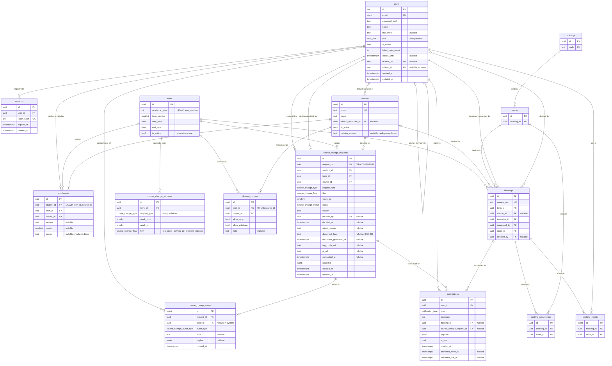

# Course Change — Entity Relationship Diagram (as implemented)

> Generated for DATA-001 from `prototype-1/backend/prisma/schema.prisma` and checked against
> the live local database (`information_schema` / `pg_indexes` / `pg_constraint`, 2026-10-09,
> after migration `20261009120000_course_catalog`). It shows **only tables that exist**.
> Things that are conceptual but not implemented are listed separately in §I.

## A. Overview

LabSync has one PostgreSQL schema (`public`) with 15 tables. Course Change (ลด / ถอนรายวิชา)
adds 5 of them and reuses 5 shared LabSync tables:

| Group | Tables |
|---|---|
| Shared identity & reference data | `users`, `sessions`, `terms`, `courses` |
| Shared messaging | `notifications` |
| Course Change only | `course_change_windows`, `allowed_courses`, `enrollments`, `course_change_requests`, `course_change_events` |
| Room booking only (not used by Course Change) | `buildings`, `rooms`, `bookings`, `booking_occurrences`, `booking_events` |

## B. Mermaid ER diagram

Column types are PostgreSQL types. `PK` primary key, `FK` foreign key, `UK` unique.
The booking tables are drawn with their keys only (full columns: `schema.prisma`).

## C. Entity descriptions (Course Change scope)

| Table | Purpose |
|---|---|
| `users` | Every account. `role = student` rows carry `student_no` and `advisor_id` (their advisor, a staff user). |
| `terms` | Academic terms. Course Change always works on the single `is_active` term. |
| `courses` | **Shared** course list (also used by room booking). `catalog_source = 'cedt-google-forms'` marks the 36 CEDT catalog courses; NULL marks LabSync booking courses (e.g. legacy `CEDT101`…), which Course Change ignores. |
| `course_change_windows` | The routing matrix: for a term and request type, which week range maps to which flow. |
| `allowed_courses` | The programme's announcement: which courses may be dropped / withdrawn this term. |
| `enrollments` | Which courses a student is registered in this term. Currently **synthetic demo data** (`source = 'synthetic-demo'`), not from Reg Chula. |
| `course_change_requests` | One drop/withdraw request. `flow` and `week_no` are snapshotted at submit; `snapshot` (JSON) freezes student/course/advisor names. |
| `course_change_events` | Append-style audit log of every step (submitted, approved, document_generated, sent_to_reg_chula, …). |
| `notifications` | **Shared** in-app inbox; Course Change rows set `course_change_request_id`. |

## D. Primary and foreign keys

All primary keys are `uuid` (`gen_random_uuid()`) except the two event logs (`bigint` identity).

| FK column | References | On delete |
|---|---|---|
| `users.advisor_id` | `users.id` | SET NULL |
| `courses.default_instructor_id` | `users.id` | SET NULL |
| `sessions.user_id` | `users.id` | CASCADE |
| `course_change_windows.term_id` | `terms.id` | CASCADE |
| `allowed_courses.term_id` | `terms.id` | CASCADE |
| `allowed_courses.course_id` | `courses.id` | RESTRICT |
| `enrollments.student_id` | `users.id` | RESTRICT |
| `enrollments.term_id` | `terms.id` | CASCADE |
| `enrollments.course_id` | `courses.id` | RESTRICT |
| `course_change_requests.student_id` | `users.id` | RESTRICT |
| `course_change_requests.term_id` | `terms.id` | RESTRICT |
| `course_change_requests.course_id` | `courses.id` | RESTRICT |
| `course_change_requests.decided_by` | `users.id` | SET NULL |
| `course_change_events.request_id` | `course_change_requests.id` | CASCADE |
| `course_change_events.actor_id` | `users.id` | SET NULL |
| `notifications.user_id` | `users.id` | RESTRICT |
| `notifications.course_change_request_id` | `course_change_requests.id` | CASCADE |
| `notifications.booking_id` | `bookings.id` | CASCADE |

Booking-side FKs (for completeness): `rooms.building_id → buildings` RESTRICT; `bookings.term_id / instructor_id / requested_by / room_id` RESTRICT; `bookings.course_id`, `bookings.decided_by` SET NULL; `booking_occurrences.booking_id` CASCADE, `.room_id` RESTRICT; `booking_events.booking_id` CASCADE, `.actor_id` RESTRICT.

**Consequence:** a course referenced by an enrollment, an announcement or a request cannot be
deleted (RESTRICT) — courses are deactivated (`is_active = false`) instead.

## E. Cardinality

- A **student** has 0..n enrollments, 0..n requests; each enrollment/request belongs to exactly one student.
- A **student** has 0..1 advisor; a staff user advises 0..n students (self-relation).
- A **term** has 0..n windows, announcements, enrollments, requests.
- A **course** appears in 0..n enrollments, announcements and requests; per term at most one announcement and, per student, at most one enrollment.
- A **request** has 1..n events (always at least `submitted`) and 0..n notifications; it is decided by 0..1 staff user.
- There is **no FK from a request to an enrollment**: the request references the course; enrollment is checked when the request is submitted (CC-BR-1).

## F. Unique constraints, indexes and checks

| Table | Constraint / index | Enforces |
|---|---|---|
| `courses` | `courses_code_key` (code) | One row per course code — the catalog seed's upsert key |
| `users` | `users_email_key`, `users_student_no_key` | No duplicate accounts / student numbers |
| `terms` | `terms_academic_year_term_number_key`; `one_active_term` (partial, `WHERE is_active`) | One row per term; at most one active term |
| `course_change_windows` | `(term_id, request_type, week_from)` unique; CHECK `ccw_week_order` (`week_from >= 1 AND week_to >= week_from`) | — overlap between windows is **not** prevented |
| `allowed_courses` | `(term_id, course_id)` unique | One announcement per course per term |
| `enrollments` | `(student_id, term_id, course_id)` unique | No duplicate enrollment |
| `course_change_requests` | `request_no` unique; **`one_live_course_change`** partial unique `(student_id, course_id, term_id) WHERE status IN (pending_approval, processing, completed)`; CHECK `ccr_reject_reason` | No duplicate live request (CC-BR-2) even under races; rejected/cancelled rows do not block a retry; a rejection always has a reason |
| `course_change_requests` | indexes `(status, created_at DESC)`, `(student_id, created_at DESC)` | Staff inbox / student history queries |
| `course_change_events` | index `(request_id, created_at)` | Timeline per request |
| `notifications` | index `(user_id, is_read, created_at DESC)` | Bell polling |

Sequences: `course_change_request_seq` (request numbers), `booking_request_seq`, and the two event-log identity sequences.

## G. How Drop/Withdrawal uses shared LabSync entities

| Shared table | Used for | Effect on other LabSync features |
|---|---|---|
| `users` | Login, roles, student number, advisor | `student` role added; LabSync staff routes reject students (403). Students appear in Master Data → Users. |
| `sessions` | Same session cookie auth | None |
| `terms` | Active term drives weeks and scoping | A new active term has no windows → Course Change closed until windows are created |
| `courses` | Catalog for enrollment / announcement / request | The 36 catalog courses now also appear in the booking course typeahead and Master Data course list (42 rows total). Placeholder courses stay, still referenced by bookings. |
| `notifications` | In-app inbox + mocked LINE flag | Shared bell; `cc_*` types route to `/course-change` |

## H. Current limitations

- `enrollments` are synthetic; there is no Reg Chula import. `section` / `credits` are NULL for them.
- `courses` has no credits column; credits live on `enrollments` and are unknown.
- Window overlap is not enforced in the DB (only by seed data).
- The audit log (`course_change_events`) is not protected against UPDATE/DELETE at the DB level.
- `snapshot` is untyped JSON (shape enforced only by TypeScript).
- The 8 requests created before DATA-001 reference placeholder courses (`CEDT…`); they remain visible to staff.

## I. Conceptual entities that are NOT implemented (proposed, not in the database)

| Conceptual entity | Today | Proposal (needs approval; backlog ID from AUDIT-001) |
|---|---|---|
| Workflow definition | Partly: `course_change_windows` (week → flow) | — |
| Workflow steps | **No table.** Constant `FLOW_STEPS` in `backend/src/modules/course-change/timeline.ts`; step state derived from events | Keep in code unless steps must be configurable |
| Approvals | **No table.** `decided_by` / `decided_at` / `reject_reason` on the request + `approved` / `rejected` events; single approval level | `request_approvals` / approver assignment (DW-105) |
| Request status history | `course_change_events` | — |
| Documents / attachments | **No table, no file storage.** Only `document_hash` + `document_generated_at`; HTML rendered on demand | `request_documents` with versions, storage key, MIME, size, uploader (DW-102/103) |
| Corrected submissions / revisions | **Not modelled** | revision link + version number (DW-103) |
| Student profile extras (phone, year of study) | **Not modelled** | columns on `users` or a `student_profiles` table (DW-101) |
| Integration outbox | **Not modelled** (adapters called inline) | `integration_outbox` (DW-106) |
