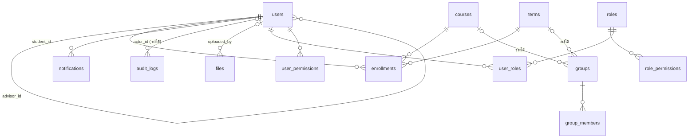

# แผนของกลาง (Global Objects) ฝั่ง Backend และฐานข้อมูล

วันที่: 23 พ.ย. 2026 · สรุปจาก [spec](../specs/2026-11-20-shared-backend-objects-design.md) คำตอบของทีม และการคุยเรื่องสิทธิ์และ model (แผนนี้แทนหัวข้อ 3 และ 7 ของ spec ในส่วนที่ขัดกัน)

**ผลที่ตัดสินแล้ว**

| เรื่อง | ที่เลือก |
|---|---|
| การจัดโค้ดและ schema | B: แยก schema เป็นหลายไฟล์ + `src/core/` + ไฟล์รวมโมดูล |
| การเก็บสิทธิ์ | RBAC ในฐานข้อมูล: บทบาท + สิทธิ์รายคน IT Admin จัดการเอง |
| ระดับสิทธิ์ | `<module>.use`, `<module>.view`, `<module>.manage` (แตกย่อยได้) |
| ผู้ใช้และนิสิต | ตาราง `users` ตารางเดียว นิสิตคือผู้ใช้ที่มี `student_no` ไม่มีตาราง `students` และไม่มี `users.role` |
| การล็อกอินของนิสิต | ผ่าน MCV สร้างแถวใน `users` ตอนล็อกอินครั้งแรก (เจ้าหน้าที่ยังไม่ตัดสิน ใช้รหัสผ่านแบบเดิมไปก่อน) |
| รูปแบบ path ของ API | แบบที่ 1: ตามทรัพยากร (เหตุผลในหัวข้อ 2.6) |
| การเก็บไฟล์ | นอกฐานข้อมูล ผ่าน `fileStore` (`local` ตอน dev, Supabase Storage ตอน demo) |
| branch ของกลาง | `core/<เรื่อง>` ชั่วคราว ติด label `shared` |

## 1. รายการของกลาง

### 1.1 ของกลาง

| ของกลาง | ตาราง | คอลัมน์หลัก | หมายเหตุ |
|---|---|---|---|
| ผู้ใช้ | `users` (ปรับของเดิม) | email, name, password_hash (ว่างได้), mcv_id, `student_no` (ว่างได้), advisor_id, is_active | ทุกคนที่ล็อกอิน รวมนิสิต `student_no` มีค่า = เป็นนิสิต |
| วิชาและเทอม | `courses`, `terms` (มีอยู่แล้ว) | ไม่เปลี่ยน | ทุกโมดูลอ้างเทอมด้วย `term_id` |
| การลงทะเบียน | `enrollments` (จาก PR #6) | student_id → users, course_id, term_id, section | ย้ายเป็นของกลาง |
| กลุ่ม | `groups`, `group_members` (ใหม่) | type, name, course_id/term_id (ว่างได้) · สมาชิก: `student_no`, role (member, leader) | สมาชิกอ้างด้วยรหัสนิสิต เพราะนำเข้าจาก CSV ก่อนนิสิตล็อกอิน |
| แจ้งเตือน | `notifications` (ปรับของเดิม) | user_id, `type`, `module`, `subject_id`, message, `link`, payload, is_read, delivered_line_at | ไม่มีคอลัมน์ FK หรือ enum ต่อโมดูลอีก |
| ประวัติการทำรายการ | `audit_logs` (ใหม่) | actor_id, module, `action`, subject_type, subject_id, before, after, note | เพิ่มได้อย่างเดียว |
| ไฟล์ | `files` (ใหม่) | storage_key, original_name, mime, size, sha256, module, uploaded_by | เนื้อไฟล์อยู่นอกฐานข้อมูล |
| สิทธิ์ | `roles`, `role_permissions`, `user_roles`, `user_permissions` (ใหม่) | บทบาท สิทธิ์ของบทบาท บทบาทของผู้ใช้ และสิทธิ์รายคน (ไม่มีวันหมดอายุ) | |

### 1.2 บทบาทเริ่มต้น

| บทบาท | ได้อย่างไร | สิทธิ์ | ใคร seed |
|---|---|---|---|
| `student` | **อัตโนมัติ** ทุกคนที่มี `student_no` (ไม่เก็บใน `user_roles`) | `.use` ของโมดูลที่ตั้งใจให้นิสิตใช้ เช่น `storage.use`, `course_change.use` | core สร้างบทบาท แต่ละโมดูลเพิ่ม `.use` ของตัวเอง |
| `it_admin` | IT Admin ให้ | `core.users.view`, `core.users.manage`, `core.permissions.manage`, `core.import.manage` | core |
| `audit` | IT Admin ให้ | `audit.view` และ `<module>.view` | core |
| เจ้าหน้าที่คลัง | IT Admin ให้ | `storage.view`, `storage.manage.*` ทุกตัว | storage |
| TA ตรวจสภาพ | IT Admin ให้ และถอนเองเมื่อจบเทอม | `storage.view`, `storage.manage.qc` | storage |
| อาจารย์ | IT Admin ให้ | `bookings.use`, `course_change.view`, `course_change.manage.advise` | bookings, course_change |

## 2. ข้อตกลงการ implement

### 2.1 ฐานข้อมูล

- **ชื่อตาราง:** snake_case พหูพจน์ ตารางกลางไม่มี prefix ตารางโมดูลขึ้นต้นด้วยชื่อโมดูล (`storage_items`)
- **ID:** uuid (`gen_random_uuid()`) ยกเว้นตาราง log และ event ใช้ bigint แบบเพิ่มเอง
- **เวลา:** `created_at` และ `updated_at` เป็น `timestamptz(6)` เก็บเป็น UTC แสดงผลตาม `APP_TZ`
- **ทิศทางการอ้างอิง:** ตารางโมดูลอ้างตารางกลางได้ ตารางกลางห้ามอ้างตารางโมดูล การอ้างตารางกลางใช้ `onDelete: Restrict`
- **การอ้างนิสิต:**
  - ข้อมูลที่เกิด**ก่อน**นิสิตล็อกอิน เช่น สมาชิกกลุ่มจาก CSV หรือการยืมหน้าเคาน์เตอร์ของนิสิตที่ยังไม่มีบัญชี ใช้ `student_no` เป็นข้อความ ไม่มี FK
  - ข้อมูลที่นิสิตทำเองหลังล็อกอิน ใช้ `user_id` FK ไป `users`
- **การลบของกลาง:** ไม่ลบจริง ใช้ `is_active`
- **ค่าคงที่:** Postgres enum ใช้เฉพาะชุดปิดภายในโมดูล ค่าที่ใช้ข้ามโมดูล (ประเภทแจ้งเตือน, action ใน audit, ชื่อสิทธิ์) เก็บเป็นข้อความขึ้นต้นด้วยชื่อโมดูล
- **เงิน:** จำนวนเต็มหน่วยสตางค์ เช่น 1,500 บาท = `150000`
- **migration:** สร้างหลัง rebase กับ `main` ล่าสุดเท่านั้น ห้ามแก้ migration ที่ merge แล้ว ถ้าผิดให้เขียน migration ใหม่

### 2.2 โครงสร้างโค้ด (แบบ B)

```
backend/
  prisma/schema/
    _base.prisma              ← datasource / generator
    core.prisma               ← ตารางของกลางทั้งหมดในหัวข้อ 3
    bookings.prisma  announcements.prisma  course-change.prisma  line.prisma  receipts.prisma  storage.prisma
  src/core/                   ← users.ts groups.ts notify.ts audit.ts files.ts permissions.ts
  src/modules/<module>/index.ts  ← export const <name>Module: AppModule ({ name, setup })
  src/modules/index.ts           ← รายชื่อโมดูล
```

- Prisma ใน lockfile เป็น 6.19.3 รองรับ multi-file schema แล้ว ตั้ง `"prisma": { "schema": "prisma/schema" }` ใน `package.json`
- `app.ts` วนลงทะเบียน route, config และ job ของทุกโมดูลจาก `src/modules/index.ts`
- env ของโมดูลขึ้นต้นด้วยชื่อโมดูล (`STORAGE_*`, `LINE_*`, `RECEIPTS_*`, `MCV_*`)
- `StudentLayout` ฝั่ง frontend ใช้กับทั้งนิสิตและอาจารย์ (เช่น จองห้อง) เปลี่ยนชื่อเป็น `PortalLayout` ใน restructure PR

### 2.3 วิธีที่โมดูลใช้ของกลาง

- **อ่าน:** อ่านหรือ join ตารางกลางผ่าน Prisma ได้ตามปกติ
- **เขียน:** เขียนตารางกลางผ่านบริการใน `src/core/` เท่านั้น ทุกบริการรับ `tx` เพื่อทำงานใน transaction เดียวกับงานของโมดูล

| บริการ | ตัวอย่าง |
|---|---|
| แจ้งเตือน | `notify(tx, { userIds, type: "storage.pickup_ready", module: "storage", subjectId, message, link })` |
| audit log | `audit(tx, { actorId, action: "storage.request.approved", subjectType: "storage_request", subjectId, before, after })` |
| ไฟล์ | `saveFile(tx, { buffer, mime, originalName, module, uploadedBy })` คืน `fileId` · `readFile(fileId)` คืน stream |
| สิทธิ์ | route: `{ config: { auth: "user", permission: "storage.manage.qc" } }` · โค้ด: `can(user, "storage.manage.qc")` |
| ผู้ใช้และกลุ่ม | `findUserByStudentNo("6632199921")` (คืน `null` ถ้ายังไม่เคยล็อกอิน), `groupsOfStudent(studentNo, termId)` |

### 2.4 รูปแบบชื่อ

- **ชื่อโมดูล:** `bookings`, `announcements`, `storage`, `course_change`, `line`, `receipts`
- **สิทธิ์:** `<module>.use`, `<module>.view`, `<module>.manage` หรือ `<module>.manage.<ส่วน>` (หัวข้อ 2.5)
- **ประเภทแจ้งเตือน:** `<module>.<เหตุการณ์>` เช่น `storage.pickup_ready`
- **action ใน audit:** `<module>.<สิ่งของ>.<การกระทำ>` เช่น `storage.request.approved`

### 2.5 สิทธิ์

**ระดับสิทธิ์ของทุกโมดูล**

| สิทธิ์ | ความหมาย |
|---|---|
| `<module>.use` | ใช้งานฝั่งผู้ใช้ เช่น ขอยืม ยื่นคำร้อง |
| `<module>.view` | ดูข้อมูลฝั่งเจ้าหน้าที่อย่างเดียว |
| `<module>.manage` | ทำรายการฝั่งเจ้าหน้าที่ โมดูลแตกเป็น `<module>.manage.<ส่วน>` ได้ |

- **ไม่มีลำดับชั้น:** `manage` ไม่ได้รวม `view` และไม่ได้รวม `manage.<ส่วน>` บทบาทต้องใส่ให้ครบเอง `can()` เทียบชื่อตรงๆ
- **แตกย่อยแล้วไม่มีตัวแม่:** ถ้าโมดูลแตก `manage` ย่อย ก็ไม่ต้องมี `<module>.manage` ตัวเดียว ตัวอย่าง storage: `storage.manage.counter` (จ่ายและรับคืน), `storage.manage.qc`, `storage.manage.inventory` (อุปกรณ์และตั้งค่า), `storage.manage.payment` (ยืนยันค่าปรับ)
- **ประกาศในโค้ด:** แต่ละโมดูล export รายชื่อสิทธิ์ของตัวเองจาก `index.ts` หน้าจัดการบทบาทเลือกได้จากรายชื่อนี้เท่านั้น ตอน start แอปเตือนถ้าฐานข้อมูลมีชื่อสิทธิ์ที่โค้ดไม่รู้จัก
- **สิทธิ์ที่ใช้จริง** = บทบาทที่เปิดใช้งานใน `user_roles` + `user_permissions` + บทบาท `student` ถ้ามี `student_no` โหลดตอน resolve session ทุก request (ไม่ cache)
- **สิทธิ์รายคน:** ให้เพิ่มได้อย่างเดียว ต้องกรอกเหตุผล หน้าจัดการผู้ใช้แสดงว่าแต่ละสิทธิ์มาจากบทบาทไหนหรือให้รายคน
- **ไม่มีวันหมดอายุและไม่มีการห้ามสิทธิ์ (deny):** ถอนบทบาทหรือสิทธิ์เอง การลงโทษเมื่อทำผิดกฎอยู่ในโมดูลเจ้าของกฎ (เช่น storage ห้ามยืมเมื่อค้างค่าปรับ) กรณีร้ายแรงปิดบัญชี รายละเอียดหน้าจัดการใน [spec หน้าจัดการสิทธิ์](../specs/2026-11-24-permissions-ui-design.md)
- **ชื่อสิทธิ์ทุกตัวมีระดับ** (`use`, `view`, `manage`) เพื่อจัดเป็นตารางในหน้าจัดการได้ เช่น `core.import.manage`
- **ห้ามตรวจความเป็นนิสิตแทนสิทธิ์:** โค้ดห้ามเขียน `if (me.isStudent)` เพื่อเปิดปิดฟีเจอร์ ใช้ `can()` เสมอ `isStudent` และ `studentNo` ใช้หาข้อมูลของตัวเองเท่านั้น

**ระดับ auth ของ route และการกันหน้าใน frontend**

| หน้าหรือ route | backend (`config`) | frontend | ตัวอย่าง |
|---|---|---|---|
| ไม่ต้องล็อกอิน | `auth: "public"` | ไม่มี `RequireAuth` | หน้าแรก, ปฏิทิน, webhook |
| ล็อกอินแล้ว ดูของตัวเอง | `auth: "user"` | `<RequireAuth>` | แจ้งเตือน, โปรไฟล์ |
| ใช้งานฝั่งผู้ใช้ | `auth: "user", permission: "storage.use"` | `<RequireAuth permission="storage.use">` | ขอยืม, ยื่นคำร้อง |
| ฝั่งเจ้าหน้าที่ | `auth: "user", permission: "storage.manage.qc"` | `<RequireAuth permission="storage.manage.qc">` | ตรวจสภาพ |

- ระดับ `any`, `admin` และ `student` เลิกใช้
- auth plugin: route ที่ไม่ใช่ `public` และแก้ข้อมูล ต้องประกาศ `permission` ไม่งั้นแอป start ไม่ขึ้น (แบบเดียวกับที่ทำกับ `auth` ตอนนี้)
- `/auth/me` คืน `user` (รวม `studentNo`) และ `permissions`
- layout `/admin` ครอบด้วย `<RequireAuth staff>` ผ่านเมื่อมี `<module>.view` ของโมดูลใดก็ได้ เมนูของแต่ละโมดูลแสดงเมื่อมี `<module>.view` ของโมดูลนั้น
- ไม่ล็อกอินไปหน้า login ล็อกอินแล้วแต่ไม่มีสิทธิ์เห็นหน้า "ไม่มีสิทธิ์เข้าถึง"
- `RequireAuth` แค่ซ่อนหน้า ตัวกันข้อมูลจริงคือ backend ทั้งสองฝั่งใช้ชื่อสิทธิ์เดียวกัน
- ระหว่างที่หน้าจัดการบทบาทยังไม่เสร็จ ใช้ seed สร้างบทบาทเริ่มต้น โมดูลไม่ต้องรอ

### 2.6 API (แบบที่ 1)

**เหตุผลที่เลือก:** คนเดียวมีได้หลายบทบาท เช่น นิสิตที่เป็น TA และสิทธิ์ตรวจราย route อยู่แล้ว ถ้าแบ่ง path เป็น `/admin` กับ `/student` (แบบที่ 2) จะต้องมี endpoint ซ้ำสองชุด และตัดสินยากว่าคนที่อยู่ทั้งสองฝั่งควรเรียกชุดไหน

```
GET  /api/v1/storage/requests              ← staff เห็นทั้งหมด, นิสิตเห็นของตัวเอง
POST /api/v1/storage/requests              ← ต้องมี storage.use
POST /api/v1/storage/requests/:id/approve  ← ต้องมี storage.manage.counter
```

- ทุก route ประกาศ `config.auth` ไม่มีกลุ่ม `/public`
- ทุก service ที่คืนข้อมูลรายคนต้องกรองผ่าน helper เช่น `visibleTo(user)` เสมอ และตัดฟิลด์ตามสิทธิ์
- ทุกโมดูลที่มีข้อมูลรายคนต้องมี test ว่านิสิตคนหนึ่งดึงข้อมูลของอีกคนไม่ได้
- ตรวจข้อมูลด้วย zod ทุก route ใช้ `AppError` กับรหัส error เดิม และ route ที่แก้ข้อมูลต้องมี header `X-Requested-With`

### 2.7 แจ้งเตือนและ LINE

- LINE sender ส่ง `message` และ `link` ของแต่ละแถวไปตรงๆ โมดูลใหม่ไม่ต้องแก้โค้ด LINE
- `message` ต้องอ่านเข้าใจได้โดยไม่ต้องเปิดเว็บ เช่น ใส่ชื่อรายการ
- `link` เป็น path ในเว็บ (`/storage/requests/123`) ไม่ใช่ URL เต็ม
- ส่งได้เฉพาะคนที่มีบัญชี

### 2.8 audit log

- เขียนทุกการเปลี่ยนแปลงที่สำคัญทางธุรกิจ ตาราง event ของโมดูลมีได้เฉพาะเมื่อใช้ตัดสินใจทางธุรกิจ
- การให้และถอนบทบาทหรือสิทธิ์รายคนเขียน audit (`core.role.assigned`, `core.role.revoked`, `core.permission.granted`, `core.permission.revoked`)
- การลบตาม retention เก็บแค่จำนวนแถวใน `note` ไม่เก็บข้อมูลที่ลบไป
- `before` และ `after` ห้ามมี token หรือรหัสผ่าน

### 2.9 ไฟล์

- `fileStore` เลือก driver ด้วย env `FILE_STORAGE`
  - `local`: โฟลเดอร์ `./storage` (ใส่ใน `.gitignore`) บันทึกที่ `<ปี>/<เดือน>/<uuid>` ไม่ใช้ชื่อไฟล์จากผู้ใช้เป็น path
  - `supabase`: Supabase Storage แบบ private bucket (ตรวจ quota ของ free tier ก่อนใช้จริง)
- `save()` อัปโหลดไฟล์ก่อนแล้วจึงเขียนแถว ถ้า transaction ล้มให้ลบไฟล์ มีสคริปต์ลบไฟล์ที่ไม่มีแถวและอายุเกินหนึ่งวัน
- ดาวน์โหลดผ่าน backend ที่ตรวจสิทธิ์เสมอ ไม่ส่งลิงก์ของ bucket ให้ผู้ใช้

### 2.10 ความปลอดภัยและการทดสอบ

- ห้าม log ข้อมูลส่วนบุคคล เช่น รหัสนิสิต ชื่อ และ token
- ทดสอบกับฐานข้อมูลแยก `<db>_test` ทุกโมดูล บริการใน `src/core/` ต้องมี test ของตัวเอง

### 2.11 บัญชีทดสอบและแถบสลับผู้ใช้ (dev และ demo เท่านั้น)

- **บัญชีทดสอบ:** seed สร้างบัญชีละบทบาท ใช้ทั้งทดสอบด้วยมือและใน test อัตโนมัติ อีเมลลงท้าย `@test.local` ทุกบัญชี

  | บัญชี | ข้อมูล | ใช้ทดสอบ |
  |---|---|---|
  | นิสิต | มี `student_no` | บทบาท `student` อัตโนมัติ |
  | นิสิตที่เป็น TA | มี `student_no` + บทบาท TA ตรวจสภาพ | เห็นทั้งฝั่งนิสิตและหน้าตรวจสภาพ |
  | เจ้าหน้าที่คลัง | บทบาทเจ้าหน้าที่คลัง | ทุกหน้าของ storage ฝั่งเจ้าหน้าที่ |
  | อาจารย์ | บทบาทอาจารย์ | จองห้องและอนุมัติคำร้องในฐานะที่ปรึกษา |
  | IT Admin | บทบาท `it_admin` | จัดการผู้ใช้และบทบาท |
  | Audit | บทบาท `audit` | ดูได้อย่างเดียว |
  | ไม่มีบทบาท | ไม่มี `student_no` และไม่มีบทบาท | เห็นแค่หน้าที่ไม่ต้องใช้สิทธิ์ |

  นิสิตทดสอบล็อกอินด้วยรหัสผ่าน เพราะ MCV ยังไม่พร้อม
- **แถบสลับผู้ใช้:** มุมจอมีป้าย "DEV" และ dropdown รายชื่อบัญชีทดสอบ เลือกแล้วล็อกอินเป็นบัญชีนั้นทันที (session ใหม่, `/auth/me` คืนสิทธิ์ของบัญชีนั้น)
  - backend: `POST /api/v1/dev/login-as` (`auth: "public"`) รับ `userId` สลับได้เฉพาะบัญชีที่อีเมลลงท้าย `@test.local`
  - ลงทะเบียน route นี้เฉพาะเมื่อ `NODE_ENV !== "production"` และ `DEV_LOGIN_AS=true`
  - ถ้าตั้ง `DEV_LOGIN_AS=true` ตอน `NODE_ENV=production` แอปต้อง start ไม่ขึ้น
  - frontend แสดงแถบเฉพาะเมื่อ `import.meta.env.DEV` หรือ env `VITE_DEV_LOGIN_AS=true` (สำหรับ demo)
  - ใช้แทน `DevStudentSwitcher` ของ storage (PR #5) ซึ่งสลับแค่นิสิตใน mock data

## 3. ร่าง schema ของกลาง

ทุก model อยู่ใน `prisma/schema/core.prisma` ตามหัวข้อ 2.2 โค้ดในหัวข้อนี้เป็นร่างให้เริ่ม implement (ผ่าน `prisma validate` แล้ว) ชื่อคอลัมน์และ index ปรับได้ใน PR ของแต่ละเรื่อง

### 3.1 ภาพรวมความสัมพันธ์



`group_members.student_no` ไม่มี FK จับคู่กับ `users.student_no` ตอนอ่าน ตารางโมดูลอ้างตารางกลางได้ทางเดียว เช่น `storage_requests.requested_by → users` หรือ `storage_items.image_file_id → files`

### 3.2 ผู้ใช้

```prisma
model User {                       // users: ทุกคนที่ล็อกอิน รวมนิสิต
  id               String    @id @default(dbgenerated("gen_random_uuid()")) @db.Uuid
  email            String    @unique @db.Citext
  name             String
  titlePrefix      String?   @map("title_prefix")
  passwordHash     String?   @map("password_hash")                // ว่างได้ ถ้าล็อกอินผ่าน MCV
  mcvId            String?   @unique @map("mcv_id")               // id ของคนนี้ใน MCV
  studentNo        String?   @unique @map("student_no") @db.Char(10)   // มีค่า = เป็นนิสิต
  advisorId        String?   @map("advisor_id") @db.Uuid
  isActive         Boolean   @default(true) @map("is_active")
  failedLoginCount Int       @default(0) @map("failed_login_count")
  lockedUntil      DateTime? @map("locked_until") @db.Timestamptz(6)
  createdAt        DateTime  @default(now()) @map("created_at") @db.Timestamptz(6)
  updatedAt        DateTime  @updatedAt @map("updated_at") @db.Timestamptz(6)
  // ไม่มี role แล้ว

  advisor       User?                @relation("advisor", fields: [advisorId], references: [id], onDelete: Restrict)
  advisees      User[]               @relation("advisor")
  enrollments   Enrollment[]
  roles         UserRoleAssignment[]
  permissions   UserPermission[]
  notifications Notification[]
  auditLogs     AuditLog[]
  files         File[]
  // relation อื่นที่มีอยู่แล้ว (sessions, bookings, announcements, ...) คงเดิม

  @@index([isActive])
  @@map("users")
}
```

- ตอนล็อกอินผ่าน MCV ครั้งแรก: หาแถวด้วย `mcv_id` ถ้าไม่เจอให้สร้างแถวใหม่ แล้วตั้ง `student_no` จากข้อมูลที่ MCV ส่งมา ยังไม่รู้ว่า MCV ส่งอะไรบ้าง ให้ทำฟังก์ชัน `studentNoFromMcv(profile)` ฟังก์ชันเดียวใน `src/core/users.ts`
- หลักสูตร ปีที่เข้า และสถานะนิสิต ยังไม่เก็บ เพิ่มเมื่อรู้ว่ามีแหล่งข้อมูล
- `SessionUser` มี `id`, `name`, `email`, `studentNo`, `isStudent` (`= studentNo != null`) และ `permissions`

### 3.3 วิชา เทอม และการลงทะเบียน

```prisma
// courses และ terms มีอยู่แล้ว เพิ่มแค่ relation
model Course {
  // ... คอลัมน์เดิม
  enrollments Enrollment[]
  groups      Group[]
}

model Term {
  // ... คอลัมน์เดิม
  enrollments Enrollment[]
  groups      Group[]
}

model Enrollment {                 // enrollments: ย้ายจาก PR #6
  id        String   @id @default(dbgenerated("gen_random_uuid()")) @db.Uuid
  studentId String   @map("student_id") @db.Uuid     // users.id ของนิสิต (เหมือน PR #6)
  termId    String   @map("term_id") @db.Uuid
  courseId  String   @map("course_id") @db.Uuid
  section   String?
  credits   Int?     @db.SmallInt
  source    String?                                  // ที่มา เช่น "synthetic-demo"
  createdAt DateTime @default(now()) @map("created_at") @db.Timestamptz(6)
  updatedAt DateTime @updatedAt @map("updated_at") @db.Timestamptz(6)

  student User   @relation(fields: [studentId], references: [id], onDelete: Restrict)
  term    Term   @relation(fields: [termId], references: [id], onDelete: Restrict)   // PR #6 ใช้ Cascade
  course  Course @relation(fields: [courseId], references: [id], onDelete: Restrict)

  @@unique([studentId, termId, courseId])
  @@index([termId, courseId, section])
  @@map("enrollments")
}
```

### 3.4 กลุ่ม

```prisma
enum GroupType {
  course_section   // กลุ่มในรายวิชา เช่น "Group 09" ต้องมี course และ term
  club             // ชมรม
  project          // โปรเจกต์
  personal         // ส่วนตัว
  @@map("group_type")
}

enum GroupMemberRole {
  member
  leader
  @@map("group_member_role")
}

model Group {                      // groups
  id          String    @id @default(dbgenerated("gen_random_uuid()")) @db.Uuid
  type        GroupType
  name        String
  courseId    String?   @map("course_id") @db.Uuid
  termId      String?   @map("term_id") @db.Uuid
  section     String?
  createdById String?   @map("created_by") @db.Uuid     // ว่างถ้ามาจาก CSV
  isActive    Boolean   @default(true) @map("is_active")
  createdAt   DateTime  @default(now()) @map("created_at") @db.Timestamptz(6)
  updatedAt   DateTime  @updatedAt @map("updated_at") @db.Timestamptz(6)

  course  Course?       @relation(fields: [courseId], references: [id], onDelete: Restrict)
  term    Term?         @relation(fields: [termId], references: [id], onDelete: Restrict)
  members GroupMember[]

  @@unique([termId, courseId, section, name])
  @@index([type, isActive])
  @@map("groups")
}

model GroupMember {                // group_members
  groupId   String          @map("group_id") @db.Uuid
  studentNo String          @map("student_no") @db.Char(10)   // จาก CSV ไม่มี FK
  role      GroupMemberRole @default(member)
  createdAt DateTime        @default(now()) @map("created_at") @db.Timestamptz(6)

  group Group @relation(fields: [groupId], references: [id], onDelete: Restrict)

  @@id([groupId, studentNo])
  @@index([studentNo])
  @@map("group_members")
}
```

- เพิ่ม CHECK ใน migration (Prisma เขียนเองไม่ได้): `type <> 'course_section' OR (course_id IS NOT NULL AND term_id IS NOT NULL)`
- `group_members.student_no` ตรวจรูปแบบตัวเลข 10 หลักด้วย CHECK เพราะไม่มี FK มาตรวจ

### 3.5 แจ้งเตือน

```prisma
model Notification {               // notifications (ปรับของเดิม)
  id               String    @id @default(dbgenerated("gen_random_uuid()")) @db.Uuid
  userId           String    @map("user_id") @db.Uuid
  type             String                         // "<module>.<เหตุการณ์>" เช่น "storage.pickup_ready"
  module           String                         // "storage"
  subjectId        String?   @map("subject_id")   // id ของสิ่งที่แจ้ง เก็บเป็นข้อความ
  message          String                         // อ่านเข้าใจได้โดยไม่ต้องเปิดเว็บ (LINE ส่งข้อความนี้ตรงๆ)
  link             String?                        // path ในเว็บ เช่น "/storage/requests/123" ไม่ใช่ URL เต็ม
  payload          Json      @default("{}")
  isRead           Boolean   @default(false) @map("is_read")
  readAt           DateTime? @map("read_at") @db.Timestamptz(6)
  deliveredLineAt  DateTime? @map("delivered_line_at") @db.Timestamptz(6)
  deliveredEmailAt DateTime? @map("delivered_email_at") @db.Timestamptz(6)
  createdAt        DateTime  @default(now()) @map("created_at") @db.Timestamptz(6)

  user User @relation(fields: [userId], references: [id], onDelete: Restrict)

  @@index([userId, isRead, createdAt(sort: Desc)])
  @@index([module, subjectId])
  @@index([deliveredLineAt])
  @@map("notifications")
}
```

migration จากของเดิม:
- แปลง enum `notification_type` เป็นข้อความ เช่น `request_approved` → `bookings.request_approved` แล้วลบ enum
- ย้าย `booking_id` ไปเป็น `subject_id` และตั้ง `module = 'bookings'` แล้วลบคอลัมน์ `booking_id` (และ `course_change_request_id` ของ PR #6)

### 3.6 ประวัติการทำรายการ

```prisma
model AuditLog {                   // audit_logs: เพิ่มได้อย่างเดียว
  id          BigInt   @id @default(autoincrement())
  actorId     String?  @map("actor_id") @db.Uuid    // ว่างถ้าระบบเป็นผู้ทำ เช่น งานลบตาม retention
  module      String
  action      String                                // "<module>.<สิ่งของ>.<การกระทำ>" เช่น "storage.request.approved"
  subjectType String   @map("subject_type")         // "storage_request"
  subjectId   String   @map("subject_id")
  before      Json?
  after       Json?
  note        String?                               // เช่น จำนวนแถวที่ลบตาม retention
  createdAt   DateTime @default(now()) @map("created_at") @db.Timestamptz(6)

  actor User? @relation(fields: [actorId], references: [id], onDelete: Restrict)

  @@index([subjectType, subjectId, createdAt])
  @@index([actorId, createdAt])
  @@index([module, createdAt])
  @@map("audit_logs")
}
```

- กันแก้และลบใน migration ด้วย trigger ที่ `RAISE EXCEPTION` เมื่อ `UPDATE` หรือ `DELETE`

### 3.7 ไฟล์

```prisma
model File {                       // files: เนื้อไฟล์อยู่นอกฐานข้อมูล
  id           String   @id @default(dbgenerated("gen_random_uuid()")) @db.Uuid
  storageKey   String   @unique @map("storage_key")   // เช่น "2026/11/<uuid>" ใน local หรือ bucket
  originalName String   @map("original_name")
  mime         String
  size         Int                                     // ไบต์
  sha256       String   @db.Char(64)
  module       String
  uploadedById String?  @map("uploaded_by") @db.Uuid
  createdAt    DateTime @default(now()) @map("created_at") @db.Timestamptz(6)

  uploadedBy User? @relation(fields: [uploadedById], references: [id], onDelete: Restrict)

  @@index([module, createdAt])
  @@map("files")
}
```

- PDF ของ course change (PR #6) ย้ายจาก bytea มาใช้ตารางนี้

### 3.8 สิทธิ์

```prisma
model Role {                       // roles
  id          String   @id @default(dbgenerated("gen_random_uuid()")) @db.Uuid
  key         String   @unique                     // "it_admin", "audit", "student", "storage_staff"
  name        String                               // ชื่อที่แสดง
  description String?
  isSystem    Boolean  @default(false) @map("is_system")   // จาก seed ลบและเปลี่ยน key ไม่ได้
  isActive    Boolean  @default(true) @map("is_active")
  createdAt   DateTime @default(now()) @map("created_at") @db.Timestamptz(6)
  updatedAt   DateTime @updatedAt @map("updated_at") @db.Timestamptz(6)

  permissions RolePermission[]
  users       UserRoleAssignment[]

  @@map("roles")
}

model RolePermission {             // role_permissions
  roleId     String   @map("role_id") @db.Uuid
  permission String                                // ต้องเป็นชื่อที่โมดูลประกาศในโค้ด
  createdAt  DateTime @default(now()) @map("created_at") @db.Timestamptz(6)

  role Role @relation(fields: [roleId], references: [id], onDelete: Cascade)

  @@id([roleId, permission])
  @@map("role_permissions")
}

model UserRoleAssignment {         // user_roles
  userId      String    @map("user_id") @db.Uuid
  roleId      String    @map("role_id") @db.Uuid
  grantedById String?   @map("granted_by") @db.Uuid
  createdAt   DateTime  @default(now()) @map("created_at") @db.Timestamptz(6)

  user User @relation(fields: [userId], references: [id], onDelete: Restrict)
  role Role @relation(fields: [roleId], references: [id], onDelete: Restrict)

  @@id([userId, roleId])
  @@index([roleId])
  @@map("user_roles")
}

model UserPermission {             // user_permissions: สิทธิ์รายคน
  userId      String    @map("user_id") @db.Uuid
  permission  String
  reason      String                                // บังคับกรอก
  grantedById String?   @map("granted_by") @db.Uuid
  createdAt   DateTime  @default(now()) @map("created_at") @db.Timestamptz(6)

  user User @relation(fields: [userId], references: [id], onDelete: Restrict)

  @@id([userId, permission])
  @@map("user_permissions")
}
```

- ชื่อ model เป็น `UserRoleAssignment` เพื่อไม่ให้สับสนกับ enum `UserRole` เดิม (ซึ่งจะถูกลบ)
- บทบาท `student` เป็นแถวใน `roles` (`is_system`) แต่ห้ามมีแถวใน `user_roles` หน้าจัดการซ่อนบทบาทนี้จากตัวเลือก
- `role_permissions` ใช้ Cascade เพราะเป็นส่วนหนึ่งของบทบาท ส่วนบทบาทไม่ลบจริง (ใช้ `is_active`)
- กันพลาดในบริการ: ห้ามถอน `it_admin` คนสุดท้าย, บทบาท `is_system` ลบไม่ได้, ผู้ใช้ให้สิทธิ์ที่ตัวเองไม่มีกับคนอื่นไม่ได้

### 3.9 ข้อยกเว้นจากข้อตกลงในหัวข้อ 2.1

| ตาราง | ข้อยกเว้น | เหตุผล |
|---|---|---|
| `audit_logs` | id เป็น bigint ไม่มี `updated_at` | log เพิ่มอย่างเดียว |
| `notifications`, `files` | ไม่มี `updated_at` | ไม่แก้หลังสร้าง สถานะการอ่านและส่งมีคอลัมน์เวลาของตัวเอง |
| `group_members`, `role_permissions`, `user_roles`, `user_permissions` | ใช้ composite key ไม่มี uuid | เป็นตารางเชื่อม |
| `group_members.student_no` | ไม่มี FK | นำเข้าก่อนนิสิตล็อกอิน |
| `role_permissions` | `onDelete: Cascade` | เป็นส่วนหนึ่งของ `roles` |

## 4. ลำดับงาน merge

แต่ละขั้น merge เข้า `main` ก่อนขั้นถัดไปเริ่ม ทุก PR ของกลางติด label `shared` ผู้ดูแลของกลางรอบปัจจุบันรีวิวก่อน แล้ว main maintainer รีวิวรอบสุดท้ายและ merge

| ขั้น | branch / PR | ทำอะไร | เสร็จเมื่อ |
|---|---|---|---|
| 0 | PR #3, #4, #6, #8 | merge ทีละตัวบน layout เดิม แต่ละตัว rebase กับ `main` ล่าสุดก่อน merge | test ของทุก PR ผ่านบน `main` |
| 1 | `core/restructure` | จัดโครงสร้างตามหัวข้อ 2.2: แยก `schema.prisma` เป็น `prisma/schema/*.prisma`, สร้าง `src/core/` และ `src/modules/index.ts`, เปลี่ยนชื่อ `StudentLayout` เป็น `PortalLayout` | test เดิมผ่านทั้งหมด และ `prisma migrate diff` ว่าง (ไม่เปลี่ยนพฤติกรรม) |
| 2 | `core/users-groups` | ปรับ `users` ตามหัวข้อ 3.2 (`password_hash` ว่างได้, `mcv_id`, `student_no` เป็น `Char(10)`), `enrollments` เป็นของกลาง (FK term เป็น Restrict), `groups`, `group_members`, endpoint นำเข้ากลุ่มด้วย CSV | test ของ `findUserByStudentNo` และ `groupsOfStudent`, test การนำเข้า CSV แบบ dryRun รวมรหัสที่ยังไม่มีบัญชี |
| 3 | `core/notifications` | ปรับ `notifications` ตามหัวข้อ 3.5 และบริการ `notify()` ย้าย bookings และ course change มาใช้ | ไม่มีคอลัมน์ FK หรือ enum ต่อโมดูลเหลือ, แจ้งเตือนเดิมยังแสดงได้ |
| 4 | `core/audit` | `audit_logs`, trigger กันแก้และลบ, บริการ `audit()` | test ว่า `UPDATE` และ `DELETE` ถูกปฏิเสธ |
| 5a | `core/permissions` | ตารางสิทธิ์ตามหัวข้อ 3.8, `can()`, คีย์ `permission` ใน auth plugin, ระดับ auth ใหม่, บทบาท `student` อัตโนมัติ, `/auth/me` คืน `permissions`, `RequireAuth` รับ `permission`, seed บทบาทเริ่มต้น, seed บัญชีทดสอบตามหัวข้อ 2.11, ลบ `users.role` | test ว่า route แก้ข้อมูลที่ไม่ประกาศ `permission` ทำให้แอป start ไม่ขึ้น, ผู้ไม่มีสิทธิ์ได้ 403, บทบาทที่ปิดไม่ให้สิทธิ์, staff เดิมยังเข้า `/admin` ได้หลัง migration, test สิทธิ์ใช้บัญชีทดสอบ |
| 5b | `core/permissions-ui` | หน้าจัดการบทบาทและสิทธิ์รายคนตาม [spec](../specs/2026-11-24-permissions-ui-design.md) | ให้และถอนบทบาทได้ เขียน audit, กันพลาดตามหัวข้อ 3.8 |
| 5c | `core/dev-switcher` | แถบสลับผู้ใช้และ `POST /api/v1/dev/login-as` ตามหัวข้อ 2.11 | สลับบัญชีทดสอบแล้วเมนูและหน้าเปลี่ยนตามสิทธิ์, test ว่าตอน production ไม่มี route นี้, test ว่าตั้ง `DEV_LOGIN_AS=true` บน production แล้วแอป start ไม่ขึ้น, test ว่าสลับไปบัญชีที่ไม่ใช่ `@test.local` ไม่ได้ |
| 6 | `core/files` | `files`, `fileStore` (driver `local` และ `supabase`), สคริปต์ลบไฟล์ค้าง ย้าย PDF ของ course change ออกจาก bytea | ดาวน์โหลดผ่าน backend ที่ตรวจสิทธิ์, ไม่มีคอลัมน์ bytea เหลือ |

**หมายเหตุ**
- **ขั้นที่ 0:** migration ของ PR #6 มี timestamp เก่ากว่า migration announcements ที่อยู่บน `main` แล้ว ให้สร้าง migration ใหม่หลัง rebase ตามหัวข้อ 2.1
- **ขั้นที่ 5a:** migration ให้ทุกคนที่ `role = staff` ได้บทบาทเริ่มต้นที่มีสิทธิ์เท่าที่ทำได้ตอนนี้ก่อนลบคอลัมน์ `role` เพื่อไม่ให้ใครหลุดสิทธิ์
- **ขั้นที่ 5b และ 5c:** เริ่มเมื่อไหร่ก็ได้หลัง 5a merge ทำพร้อมกันได้ โมดูลอื่นไม่ต้องรอ

### 4.1 โมดูลปรับตามหลังของกลาง merge

| โมดูล | ปรับอะไร | หลังขั้น |
|---|---|---|
| receipts (PR #4) | อ้างนิสิตตามกฎหัวข้อ 2.1 (`student_no` หรือ `user_id`), `term` เป็น `term_id`, เงินเป็นสตางค์, env `RECEIPTS_*`, สิทธิ์ `receipts.view` และ `receipts.manage`, เขียน audit ตอน check และ delete | 2, 4, 5a |
| LINE (PR #3) | ย้าย `line_user_id` และ `line_linked_at` ไป `line_accounts`, sender ใช้ `message` และ `link`, เขียน audit ตอน link และ unlink | 3, 4 |
| course change (PR #6) | แทน `me.role` ด้วย `can()` และ `studentNo`, สิทธิ์ `course_change.use`, `course_change.view`, `course_change.manage` และ `course_change.manage.advise`, ใช้ `notify()`, `audit()` และ `fileStore` | 3 ถึง 6 |
| storage (PR #5) | ยังไม่มี backend เริ่มบน layout ใหม่ได้หลังขั้นที่ 1 ใช้สิทธิ์ `storage.use`, `storage.view` และ `storage.manage.counter/qc/inventory/payment` ผู้ยืมหน้าเคาน์เตอร์อ้างด้วย `student_no`, ลบ `DevStudentSwitcher` หลังขั้น 5c | 1 เป็นต้นไป |
| bookings | ใช้ `notify()` แทนคอลัมน์ `booking_id`, สิทธิ์ `bookings.use` (อาจารย์ขอจอง), `bookings.view` และ `bookings.manage` | 3, 5a |
