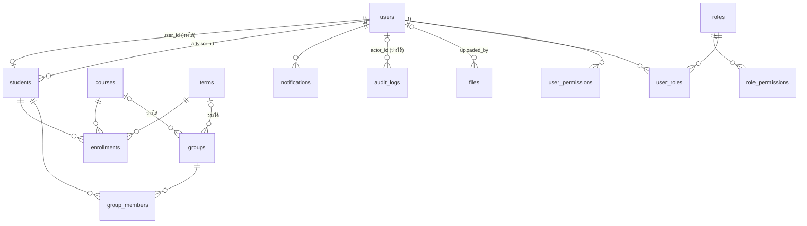

# ของกลาง (Global Objects) ฝั่ง Backend และฐานข้อมูล

วันที่ร่าง: 20 พ.ย. 2026 · ใช้ประกอบการประชุมทีมเรื่อง backend และฐานข้อมูล

## 1. เป้าหมาย

หลังประชุม ทีมควรได้ข้อสรุปสองเรื่อง

1. ของกลางมีอะไรบ้าง ใช้ร่วมกันทุกโมดูล และใครดูแล
2. ข้อตกลงการ implement ที่ทุกโมดูลต้องทำตามเวลาใช้ของกลาง

เอกสารนี้ไม่ลงรายละเอียดการแก้ PR ที่เปิดอยู่หรือลำดับการ merge

## 2. สภาพปัจจุบัน (จาก `main` และ PR #3 ถึง #6)

| เรื่อง | ที่เป็นอยู่ | ปัญหา |
|---|---|---|
| นิสิต | PR #6 เพิ่ม `studentNo` และ `advisorId` ใน `users` ส่วนระบบตรวจใบเสร็จ (#4) และระบบยืมอุปกรณ์ (#5) เก็บรหัสนิสิตเป็นข้อความ | ข้อมูลนิสิตกระจาย ไม่มีที่เดียวที่เชื่อถือได้ |
| กลุ่ม | ระบบยืมอุปกรณ์อ้าง "Group 09", ชมรม และโปรเจกต์ส่วนตัวเป็นข้อความ | ไม่มีตารางกลุ่ม |
| เทอม | ระบบตรวจใบเสร็จเก็บเทอมเป็นข้อความ เช่น `1/2569` ทั้งที่มีตาราง `terms` | อ้างไม่ตรงกัน |
| แจ้งเตือน | ตารางเดียว แต่แต่ละโมดูลเพิ่มคอลัมน์ FK (`bookingId`, `courseChangeRequestId`) และค่า enum ของตัวเอง | ต้องแก้ตารางกลางทุกครั้งที่มีโมดูลใหม่ |
| ประวัติ | `BookingEvent`, `CourseChangeEvent`, `CourseChangeSettingsEvent` มีโครงคล้ายกัน | ไม่มีที่ดูประวัติรวม |
| ไฟล์ | PR #6 เก็บ PDF เป็น bytes ในตารางของตัวเอง ระบบยืมอุปกรณ์ต้องเก็บรูปและสลิป | ต่างคนต่างทำ |
| สิทธิ์ | role มีแค่ `staff` และ `student` (PR #6) | ไม่รองรับ TA, IT Admin, Audit หรือ Central staff |
| PR ชนกัน | PR ทั้งสี่ชนกันที่ `schema.prisma`, `app.ts`, `config.ts`, `package.json` และ `.env.example` | merge ยาก |

## 3. ของกลาง

### 3.1 รายการของกลาง

| ของกลาง | ตาราง | คอลัมน์หลัก | หมายเหตุ |
|---|---|---|---|
| บัญชีผู้ใช้ | `users` (มีอยู่แล้ว) | email, password_hash, name, `role` (staff / student), is_active | ใช้ล็อกอินเท่านั้น |
| นิสิต | `students` (ใหม่) | `student_no` (10 หลัก ไม่ซ้ำ), ชื่อ, ปีที่เข้า, หลักสูตร, `advisor_id → users`, สถานะ (กำลังศึกษา, จบ, พ้นสภาพ), `user_id → users` (ว่างได้, ไม่ซ้ำ) | มีครบทุกคน แม้คนที่ไม่เคยล็อกอิน ย้าย `studentNo` และ `advisorId` ออกจาก `users` |
| สิทธิ์ | ดูหัวข้อ 5.2 | | role หลักยังเป็น staff / student สิทธิ์ละเอียดแยกต่อโมดูล |
| วิชาและเทอม | `courses`, `terms` (มีอยู่แล้ว) | ไม่เปลี่ยน | ทุกโมดูลอ้างเทอมด้วย `term_id` |
| การลงทะเบียน | `enrollments` (มาจาก PR #6) | student_id → students, course_id, term_id, section | ย้ายเป็นของกลาง |
| กลุ่ม | `groups`, `group_members` (ใหม่) | `type` (course_section, club, project, personal), name, course_id และ term_id (ว่างได้), section, is_active · สมาชิก: group_id, student_id, role (member, leader) | ใช้แทนกลุ่มที่เป็นข้อความ |
| แจ้งเตือน | `notifications` (ปรับของเดิม) | user_id, `type` เช่น `storage.pickup_ready`, `module`, `subject_id`, message, `link`, payload, is_read, delivered_line_at, delivered_email_at | เลิกเพิ่มคอลัมน์ FK และ enum ต่อโมดูล ส่งได้เฉพาะคนที่มีบัญชี |
| ประวัติการทำรายการ | `audit_logs` (ใหม่) | actor_id (ว่างได้ ถ้าระบบเป็นผู้ทำ), module, `action` เช่น `storage.request.approved`, subject_type, subject_id, before, after, note, created_at | เขียนเพิ่มได้อย่างเดียว ตาราง event ของโมดูลมีได้เฉพาะเมื่อใช้ตัดสินใจทางธุรกิจ |
| ไฟล์ | `files` (ใหม่) | original_name, mime, size, sha256, module, uploaded_by, created_at และ `storage_key` หรือ `data` ตามหัวข้อ 5.4 | โมดูลอ้างด้วย `file_id` อ่านเขียนผ่าน `fileStore` เท่านั้น |

### 3.2 ที่ตั้งใจไม่ให้เป็นของกลาง

- **ค่าปรับและการชำระเงิน:** อยู่ในระบบยืมอุปกรณ์ ออกแบบให้แยกออกมาเป็นของกลางได้เมื่อมีโมดูลที่สองต้องใช้
- **การตรวจใบเสร็จค่าเทอม:** อยู่ในโมดูลของตัวเอง แต่ให้อ้าง `students` และ `terms`
- **ตารางของ LINE** (`line_link_tokens`, `line_webhook_events`): อยู่ในโมดูล LINE

### 3.3 ข้อมูลเข้าระบบอย่างไร

- นิสิตและกลุ่มในรายวิชานำเข้าด้วย CSV แบบเดียวกับ `/import/courses` ที่มีอยู่ คือมีโหมด dryRun และรายงานผลรายแถว
- เพิ่ม endpoint นำเข้านิสิตและนำเข้ากลุ่ม
- กลุ่มชมรมและโปรเจกต์ส่วนตัวสร้างในระบบได้

### 3.4 บทบาทที่คาดว่าจะมี

บทบาทต่อไปนี้ไม่ใช่ role ใหม่ในฐานข้อมูล แต่เป็นชุดสิทธิ์ (ดูหัวข้อ 5.2)

| บทบาท | role หลัก | ตัวอย่างสิทธิ์ |
|---|---|---|
| IT Admin | staff | `core.users.manage`, `core.permissions.manage`, `core.import` |
| Audit | staff | `audit.read` และ `<module>.read` ของทุกโมดูล |
| Central staff | staff | สิทธิ์ของหลายโมดูล เช่น `course_change.approve`, `receipts.check` |
| เจ้าหน้าที่ยืมอุปกรณ์ / TA | staff | `storage.manage`, `storage.qc` |
| อาจารย์ที่ปรึกษา | staff | `course_change.advise` |

## 4. ข้อตกลงการ implement

### 4.1 ฐานข้อมูล

- **ชื่อตาราง:** snake_case พหูพจน์ ตารางกลางไม่มี prefix เช่น `students` ส่วนตารางโมดูลขึ้นต้นด้วยชื่อโมดูล เช่น `storage_items`
- **ID:** uuid (`gen_random_uuid()`) ยกเว้นตาราง log และ event ใช้ bigint แบบเพิ่มเอง
- **เวลา:** ทุกตารางมี `created_at` และ `updated_at` เป็น `timestamptz(6)` เก็บเป็น UTC แสดงผลตาม `APP_TZ`
- **ทิศทางการอ้างอิง:** ตารางโมดูลอ้างตารางกลางได้ ตารางกลางห้ามอ้างตารางโมดูล การอ้างตารางกลางใช้ `onDelete: Restrict`
- **การลบของกลาง:** ไม่ลบจริง ใช้ `is_active` แทน
- **ค่าคงที่:** Postgres enum ใช้เฉพาะค่าที่เป็นชุดปิดภายในโมดูล ค่าที่ใช้ข้ามโมดูล (ประเภทแจ้งเตือน, action ใน audit, ชื่อสิทธิ์) เก็บเป็นข้อความขึ้นต้นด้วยชื่อโมดูล
- **เงิน:** จำนวนเต็มหน่วยสตางค์ เช่น 1,500 บาท = `150000`

### 4.2 วิธีที่โมดูลใช้ของกลาง

- **อ่าน:** อ่านหรือ join ตารางกลางผ่าน Prisma ได้ตามปกติ
- **เขียน:** เขียนตารางกลางผ่านบริการใน `src/core/` เท่านั้น ทุกบริการรับ `tx` เพื่อทำงานใน transaction เดียวกับงานของโมดูล

| บริการ | ตัวอย่าง |
|---|---|
| แจ้งเตือน | `notify(tx, { userIds, type: "storage.pickup_ready", module: "storage", subjectId, message, link })` |
| audit log | `audit(tx, { actorId, action: "storage.request.approved", subjectType: "storage_request", subjectId, before, after })` |
| ไฟล์ | `saveFile(tx, { buffer, mime, originalName, module, uploadedBy })` คืน `fileId` · `readFile(fileId)` คืน stream |
| สิทธิ์ | route: `{ config: { auth: "any", permission: "storage.manage" } }` · โค้ด: `can(user, "storage.qc")` |
| นิสิตและกลุ่ม | `findStudentByNo("6632199921")`, `groupsOfStudent(studentId, termId)` |

### 4.3 รูปแบบชื่อ

- **ชื่อโมดูล:** `bookings`, `announcements`, `storage`, `course_change`, `line`, `receipts`
- **สิทธิ์:** `<module>.<สิ่งที่ทำ>` เช่น `storage.manage`, `course_change.approve`
- **ประเภทแจ้งเตือน:** `<module>.<เหตุการณ์>` เช่น `storage.pickup_ready`
- **action ใน audit:** `<module>.<สิ่งของ>.<การกระทำ>` เช่น `storage.request.approved`
- **env:** ขึ้นต้นด้วยชื่อโมดูล เช่น `STORAGE_*`, `LINE_*`, `RECEIPTS_*`

### 4.4 API ความปลอดภัย และการทดสอบ

- ตรวจข้อมูลด้วย zod ทุก route และใช้ `AppError` กับรหัส error เดิม
- route ที่แก้ข้อมูลต้องมี header `X-Requested-With` (แบบเดิม)
- ห้าม log ข้อมูลส่วนบุคคล เช่น รหัสนิสิต ชื่อ และ token
- ทดสอบกับฐานข้อมูลแยก `<db>_test` (มาจาก PR #6) ทุกโมดูล บริการใน `src/core/` ต้องมี test ของตัวเอง
- รูปแบบ path ของ API ดูหัวข้อ 5.3

## 5. เรื่องที่ทีมต้องตัดสินในที่ประชุม

| เรื่อง | ตัวเลือก | คำแนะนำ |
|---|---|---|
| 5.1 การจัดโค้ดและ schema | A schema ไฟล์เดียว · B แยกหลายไฟล์ | B |
| 5.2 การเก็บสิทธิ์ | ข บทบาทในโค้ด · ค RBAC ในฐานข้อมูล | ค |
| 5.3 รูปแบบ path ของ API | 1 ตามทรัพยากร · 2 `/admin` + `/student` · 3 ทรัพยากร + `/me` | 1 |
| 5.4 การเก็บไฟล์ | โฟลเดอร์ไฟล์ · เก็บในฐานข้อมูล | ให้ทีมเลือก |
| 5.5 branch สำหรับของกลาง | `core` ถาวร · `core/<เรื่อง>` ชั่วคราว | `core/<เรื่อง>` |

### 5.1 การจัดโค้ดและ schema

**A: schema ไฟล์เดียว + `src/core/`**
```
backend/
  prisma/schema.prisma        ← ทุกตารางอยู่ในไฟล์นี้
  src/core/                   ← students.ts groups.ts notify.ts audit.ts files.ts permissions.ts
  src/modules/storage/
  src/app.ts  src/config.ts   ← ทุกโมดูลเพิ่มบรรทัดที่นี่
```
- **implement:** สร้าง `src/core/` ย้ายบริการของกลางเข้าไป โมดูลใหม่เพิ่มตารางใน `schema.prisma` เพิ่ม route ใน `app.ts` และเพิ่ม env ใน `config.ts`
- **ข้อดี:** เปลี่ยนจากตอนนี้น้อยที่สุด ทีมคุ้นเคย
- **ข้อเสีย:** ทุก PR ยังแก้สามไฟล์เดียวกันและชนกันทุกครั้ง `schema.prisma` จะยาวเป็นหลายพันบรรทัด

**B: แยก schema เป็นหลายไฟล์ + `src/core/` + ไฟล์รวมโมดูล (แนะนำ)**
```
backend/
  prisma/schema/
    _base.prisma              ← datasource / generator
    core.prisma               ← User, Student, Group, Course, Term, Notification, AuditLog, File, สิทธิ์
    storage.prisma  course-change.prisma  line.prisma  receipts.prisma
  src/core/
  src/modules/storage/index.ts   ← export { routes, configSchema, jobs }
  src/modules/index.ts           ← รายชื่อโมดูล (เพิ่มโมดูลแก้บรรทัดเดียว)
```
- **implement:**
  - ใช้ Prisma multi-file schema ตั้ง path ใน `package.json` เป็น `prisma/schema`
  - ต้องใช้ Prisma 6.7 ขึ้นไป หรือเปิด preview flag ในรุ่นก่อนหน้า (ตรวจเวอร์ชันจริงใน lockfile)
  - `app.ts` วนลงทะเบียน route และ config ของทุกโมดูลจาก `src/modules/index.ts`
- **ข้อดี:**
  - PR แต่ละโมดูลแก้แต่ไฟล์ของตัวเอง
  - ฐานข้อมูลเดียวกัน foreign key ข้ามโมดูลยังใช้ได้
  - ไม่ต้องย้ายตารางหรือข้อมูลเดิม
- **ข้อเสีย และวิธีรับมือ:**
  1. **ต้องจัดโครงสร้างครั้งแรก และ PR ที่เปิดอยู่ต้อง rebase:** ทำเป็น PR แยกที่ไม่เปลี่ยนพฤติกรรม แล้ว merge ก่อน
  2. **ต้องใช้ Prisma รุ่นที่รองรับ:** อาจต้องอัปเกรด และทุกคนอัปเดต extension ของ editor
  3. **`core.prisma` ยังถูกแตะทีละบรรทัด:** Prisma บังคับ relation สองฝั่ง เช่น ต้องเพิ่ม `storageRequests StorageRequest[]` ใน `Student` ชนน้อยลงแต่ไม่ใช่ศูนย์
  4. **ไม่ได้แก้ลำดับ migration:** โฟลเดอร์ migration ยังมีชุดเดียว ใช้กฎในหัวข้อ 6
  5. **ไม่ได้แยกขาดจริง:** Prisma client ตัวเดียว โมดูลไหนก็ query ตารางอื่นได้ ใช้กฎ "เขียนของกลางผ่าน `src/core/` เท่านั้น" และการรีวิว
  6. **อ่านตามยากขึ้นเล็กน้อย:** route ไม่ได้อยู่ใน `app.ts` ตรงๆ ความสัมพันธ์กระจายหลายไฟล์ และ config ของโมดูลใดผิดจะทำให้แอปทั้งตัวเปิดไม่ขึ้น ใช้ prefix env ตามชื่อโมดูลกันชื่อซ้ำ

### 5.2 การเก็บสิทธิ์

สิทธิ์ที่ใช้จริงของแต่ละคน = สิทธิ์จากทุกบทบาทที่ได้รับ + สิทธิ์พิเศษรายคน ทุกแบบตรวจด้วย `can(user, "...")` เหมือนกัน โค้ดของโมดูลจึงไม่เปลี่ยนตามแบบที่เลือก

| | ข. บทบาทรายคน + สิทธิ์ต่อบทบาทในโค้ด | ค. RBAC เต็มรูปแบบในฐานข้อมูล (แนะนำ) |
|---|---|---|
| ตาราง | `user_roles` (user, ชื่อบทบาท) และ `user_permissions` (สิทธิ์พิเศษรายคน) | `roles`, `role_permissions`, `user_roles` และ `user_permissions` |
| บทบาทมีสิทธิ์อะไร | ประกาศในโค้ด เช่น `ROLES.audit = ["audit.read", "storage.read"]` | IT Admin แก้ได้จากหน้าเว็บ |
| เพิ่มสิทธิ์ให้บทบาทที่มีคนอยู่แล้ว | แก้โค้ดที่เดียว ทุกคนได้ทันที | แก้ในหน้าเว็บ ทุกคนได้ทันที |
| สร้างบทบาทใหม่ | แก้โค้ดและ deploy | ทำในหน้าเว็บได้เลย |
| งานเพิ่ม | น้อย | ต้องทำหน้าจัดการบทบาทและสิทธิ์ |

- **implement (ทั้งสองแบบ):** เพิ่มคีย์ `permission` ใน route config แล้วให้ auth plugin ตรวจ โหลดสิทธิ์ของผู้ใช้ตอน resolve session และแต่ละโมดูลประกาศรายชื่อสิทธิ์ของตัวเองในโค้ด
- **เหตุผลที่แนะนำ ค:** เมื่อเว็บรวมหลายโมดูลและมี IT Admin, Audit และ Central staff การสร้างและปรับบทบาทได้เองโดยไม่ต้อง deploy คุ้มกับงานที่เพิ่มขึ้น

### 5.3 รูปแบบ path ของ API

ทุกแบบยังตรวจ permission ราย route

**แบบที่ 1: ตามทรัพยากร (แนะนำ, แบบที่ PR #6 ใช้)**
```
GET  /api/v1/storage/requests              ← staff เห็นทั้งหมด, student เห็นของตัวเอง
POST /api/v1/storage/requests              ← student สร้างคำขอ
POST /api/v1/storage/requests/:id/approve  ← ต้องมี storage.manage
```
- **ข้อดี:** ไม่มี endpoint ซ้ำ เป็นแบบ REST ทั่วไป PR #6 ไม่ต้องแก้
- **ข้อเสีย:** ถ้าลืมกรองข้อมูลใน service นิสิตอาจเห็นของคนอื่น และต้องตัดฟิลด์ตามบทบาท
- **กฎเพิ่มถ้าเลือกแบบนี้:** ทุก service ที่คืนข้อมูลรายคนต้องกรองผ่าน helper เช่น `visibleTo(user)` เสมอ

**แบบที่ 2: `/admin` และ `/student`**
```
GET  /api/v1/storage/admin/requests        ← ฝั่งเจ้าหน้าที่ (ตรวจ permission ต่อ)
GET  /api/v1/storage/student/requests      ← ของนิสิตที่ล็อกอินอยู่เสมอ
POST /api/v1/line/public/webhook           ← ไม่ต้องล็อกอิน
GET  /api/v1/core/admin/users              ← งาน IT Admin และ Audit
```
- **ข้อดี:** ตรวจสิทธิ์ครั้งเดียวที่ prefix ลืมยาก แต่ละฝั่งออกแบบคำตอบได้เต็มที่ ตรงกับหน้าเว็บที่แบ่ง `/admin` อยู่แล้ว
- **ข้อเสีย:** บาง endpoint มีสองชุด (ให้เรียก service เดียวกัน) PR #6 ต้องเปลี่ยน path และต้องมีกลุ่ม `/public`

**แบบที่ 3: ทรัพยากร + `/me`**
```
GET  /api/v1/storage/requests              ← เจ้าหน้าที่
GET  /api/v1/storage/me/requests           ← ของตัวเอง
```
- **ข้อดี:** ความปลอดภัยใกล้แบบที่ 2 และชื่อแบบ REST มากกว่า `me` ใช้ได้กับทุกคนที่ล็อกอิน
- **ข้อเสีย:** ยังต้องตรวจสิทธิ์ราย route ฝั่งเจ้าหน้าที่ และ PR #6 ต้องแก้บางส่วน

### 5.4 การเก็บไฟล์

ทั้งสองแบบใช้ตาราง `files` กลางและบริการ `fileStore` (`save()`, `read(key)`, `remove(key)`) เลือกด้วย env `FILE_STORAGE` โค้ดของโมดูลไม่ต้องรู้ว่าไฟล์อยู่ที่ไหน และเปลี่ยนแบบภายหลังได้

| | ไฟล์อยู่นอกฐานข้อมูล (โฟลเดอร์ไฟล์) | ไฟล์อยู่ในฐานข้อมูล (bytea) |
|---|---|---|
| ขนาดฐานข้อมูล | เล็ก มีแค่ข้อมูลของไฟล์ | โตเร็ว เช่น 5 MB × 30 ไฟล์ × หลายร้อยคำร้อง |
| การสำรองข้อมูล | สองที่: `pg_dump` + คัดลอกโฟลเดอร์ (เช่น `rsync`) | ที่เดียว: `pg_dump` แต่นานขึ้นตามขนาด |
| ความสอดคล้อง | อาจมีไฟล์ค้างหรือแถวที่ไฟล์หาย ต้องมีงานเก็บกวาด | ลบแถวแล้วไฟล์หายไปด้วยใน transaction เดียว |
| ความเร็วและหน่วยความจำ | ส่งแบบ stream จากดิสก์ ไม่กินหน่วยความจำ | โหลดทั้งก้อนเข้าหน่วยความจำก่อนส่ง และ query ที่เผลอดึง `data` จะช้า |
| ตั้งค่าเครื่องนักพัฒนา | ต้องมีโฟลเดอร์ `./storage` (ใส่ใน `.gitignore`) | ไม่ต้องตั้งเพิ่ม |
| ขยายระบบ | เพิ่มตัวเก็บแบบ S3 หรือ MinIO ใน `fileStore` ได้ภายหลัง | ถ้าไฟล์เยอะต้องย้ายออก ซึ่งเป็นงานใหญ่ |
| เหมาะกับ | ไฟล์ที่จะเพิ่มขึ้นเรื่อยๆ (สลิป รูปอุปกรณ์ PDF) | ไฟล์น้อยและเล็ก |

**implement แบบโฟลเดอร์ไฟล์:**
- ตั้ง `FILE_STORAGE_DIR=./storage`
- บันทึกไฟล์ที่ `storage/<ปี>/<เดือน>/<uuid>` ไม่ใช้ชื่อไฟล์จากผู้ใช้เป็น path เพื่อกันการเจาะ path ชื่อจริงเก็บใน `files.original_name`
- ดาวน์โหลดด้วยการตรวจสิทธิ์ แล้ว `reply.send(fs.createReadStream(path))`
- ขึ้นเซิร์ฟเวอร์จริงผูกโฟลเดอร์เป็น Docker volume
- เหมาะกับ backend เครื่องเดียว ถ้ามีหลายเครื่องต้องเปลี่ยนเป็น MinIO หรือ S3 (`@aws-sdk/client-s3`) ผ่าน `fileStore` ตัวเดิม

**implement แบบในฐานข้อมูล:**
- ตาราง `files` มีคอลัมน์ `data Bytes`
- `fileStore.save()` เขียนแถวพร้อมเนื้อไฟล์ใน transaction ของโมดูล ส่วน `read()` select คอลัมน์ `data` เฉพาะตอนดาวน์โหลด
- query รายการไฟล์ต้องระบุ `select` เสมอ ห้ามดึง `data`

### 5.5 branch สำหรับของกลาง

| | `core/<เรื่อง>` ชั่วคราว (แนะนำ) | `core` ถาวรตัวเดียว |
|---|---|---|
| ตัวอย่าง | `core/students-groups`, `core/notifications` | ทุกการแก้ของกลางรวมใน `core` |
| วิธีใช้ | แตกจาก `main` ต่อเรื่อง เปิด PR แล้ว merge กลับ `main` | แตกจาก `main` ครั้งเดียว merge เข้า `main` เป็นรอบ และต้องดึง `main` กลับเข้ามาเป็นระยะ |
| โมดูลใช้ของกลางใหม่ได้เมื่อ | PR ของกลาง merge เข้า `main` | รอบ merge `core` → `main` |
| ขนาด PR | เล็ก เรื่องละ PR | ใหญ่ขึ้นเรื่อยๆ |
| ความเสี่ยง | ต่ำ เหมือน `feature/` ที่ใช้อยู่ | branch ห่างจาก `main` และ conflict สะสม |
| ดูประวัติย้อนหลัง | ติด label `shared` ให้ PR หรือ `git log -- src/core` และไม่ลบ branch หลัง merge ได้ | ดูใน branch `core` (มี commit จากการ sync `main` ปน) |

สองแบบนี้ใช้พร้อมกันไม่ได้ เพราะ Git ไม่ยอมให้มี branch ชื่อ `core` คู่กับ `core/...`

## 6. ขั้นตอนการทำงานร่วมกัน

- **ผู้ดูแลของกลาง:** หมุนเวียนกันดูแล ผู้ดูแลรอบปัจจุบันรีวิว PR ที่แก้ของกลาง
- **branch:** แก้ของกลางใน branch ตามหัวข้อ 5.5 แล้ว merge ก่อน PR ของโมดูลที่ใช้ของกลางนั้น
- **migration:**
  - สร้าง migration หลัง rebase กับ `main` ล่าสุดเท่านั้น
  - ห้ามแก้ migration ที่ merge แล้ว ถ้าผิดให้เขียน migration ใหม่

## 7. ร่าง schema ของกลาง

ร่างนี้ใช้ผลที่ทีมเลือก ได้แก่ สิทธิ์แบบ ค (RBAC ในฐานข้อมูล) และไฟล์อยู่นอกฐานข้อมูล ทุก model อยู่ใน `prisma/schema/core.prisma` ตามแบบ B โค้ดในหัวข้อนี้เป็นร่างให้เริ่ม implement ชื่อคอลัมน์และ index ปรับได้ใน PR ของแต่ละเรื่อง

### 7.1 ภาพรวมความสัมพันธ์



ตารางโมดูลอ้างตารางกลางได้ทางเดียว เช่น `storage_requests.student_id → students` หรือ `storage_items.image_file_id → files`

### 7.2 บัญชีผู้ใช้และนิสิต

```prisma
enum UserRole {
  staff
  student
  @@map("user_role")
}

model User {                       // users: ใช้ล็อกอินเท่านั้น
  id               String    @id @default(dbgenerated("gen_random_uuid()")) @db.Uuid
  email            String    @unique @db.Citext
  passwordHash     String    @map("password_hash")
  name             String
  titlePrefix      String?   @map("title_prefix")
  role             UserRole
  isActive         Boolean   @default(true) @map("is_active")
  failedLoginCount Int       @default(0) @map("failed_login_count")
  lockedUntil      DateTime? @map("locked_until") @db.Timestamptz(6)
  createdAt        DateTime  @default(now()) @map("created_at") @db.Timestamptz(6)
  updatedAt        DateTime  @updatedAt @map("updated_at") @db.Timestamptz(6)

  student       Student?
  advisees      Student[]           @relation("advisor")
  roles         UserRoleAssignment[] @relation("assignee")
  permissions   UserPermission[]     @relation("grantee")
  notifications Notification[]
  auditLogs     AuditLog[]
  files         File[]
  // relation อื่นที่มีอยู่แล้ว (sessions, bookings, announcements, ...) คงเดิม

  @@index([role, isActive])
  @@map("users")
}

enum StudentStatus {
  studying     // กำลังศึกษา
  graduated    // จบ
  dismissed    // พ้นสภาพ
  @@map("student_status")
}

model Student {                    // students: มีครบทุกคน แม้ยังไม่เคยล็อกอิน
  id          String        @id @default(dbgenerated("gen_random_uuid()")) @db.Uuid
  studentNo   String        @unique @map("student_no") @db.Char(10)
  titlePrefix String?       @map("title_prefix")
  firstName   String        @map("first_name")
  lastName    String        @map("last_name")
  email       String?       @db.Citext            // อีเมลจุฬาฯ ใช้เชิญสร้างบัญชี
  entryYear   Int           @map("entry_year") @db.SmallInt   // ปีที่เข้า (พ.ศ.)
  program     String                              // หลักสูตร
  status      StudentStatus @default(studying)
  advisorId   String?       @map("advisor_id") @db.Uuid
  userId      String?       @unique @map("user_id") @db.Uuid
  createdAt   DateTime      @default(now()) @map("created_at") @db.Timestamptz(6)
  updatedAt   DateTime      @updatedAt @map("updated_at") @db.Timestamptz(6)

  advisor     User?         @relation("advisor", fields: [advisorId], references: [id], onDelete: Restrict)
  user        User?         @relation(fields: [userId], references: [id], onDelete: Restrict)
  enrollments Enrollment[]
  memberships GroupMember[]

  @@index([entryYear, status])
  @@index([advisorId])
  @@map("students")
}
```

- ย้าย `studentNo` และ `advisorId` ของ PR #6 จาก `users` มาไว้ที่ `students`
- ตอนนักศึกษาสร้างบัญชี ระบบผูก `students.user_id` จากอีเมลหรือรหัสนิสิต
- LINE ย้าย `line_user_id` ออกจาก `users` ไปตาราง `line_accounts` ในโมดูล LINE

### 7.3 วิชา เทอม และการลงทะเบียน

```prisma
// courses และ terms มีอยู่แล้ว เพิ่มแค่ relation
model Course {
  // ... คอลัมน์เดิม
  enrollments Enrollment[]
  groups      Group[]
}

model Term {
  // ... คอลัมน์เดิม
  enrollments Enrollment[]
  groups      Group[]
}

model Enrollment {                 // enrollments: ย้ายจาก PR #6
  id        String   @id @default(dbgenerated("gen_random_uuid()")) @db.Uuid
  studentId String   @map("student_id") @db.Uuid     // เปลี่ยนจาก users เป็น students
  termId    String   @map("term_id") @db.Uuid
  courseId  String   @map("course_id") @db.Uuid
  section   String?
  credits   Int?     @db.SmallInt
  source    String?                                  // ที่มา เช่น "csv-import"
  createdAt DateTime @default(now()) @map("created_at") @db.Timestamptz(6)
  updatedAt DateTime @updatedAt @map("updated_at") @db.Timestamptz(6)

  student Student @relation(fields: [studentId], references: [id], onDelete: Restrict)
  term    Term    @relation(fields: [termId], references: [id], onDelete: Restrict)   // PR #6 ใช้ Cascade
  course  Course  @relation(fields: [courseId], references: [id], onDelete: Restrict)

  @@unique([studentId, termId, courseId])
  @@index([termId, courseId, section])
  @@map("enrollments")
}
```

### 7.4 กลุ่ม

```prisma
enum GroupType {
  course_section   // กลุ่มในรายวิชา เช่น "Group 09" ต้องมี course และ term
  club             // ชมรม
  project          // โปรเจกต์
  personal         // ส่วนตัว
  @@map("group_type")
}

enum GroupMemberRole {
  member
  leader
  @@map("group_member_role")
}

model Group {                      // groups
  id          String    @id @default(dbgenerated("gen_random_uuid()")) @db.Uuid
  type        GroupType
  name        String
  courseId    String?   @map("course_id") @db.Uuid
  termId      String?   @map("term_id") @db.Uuid
  section     String?
  createdById String?   @map("created_by") @db.Uuid     // ว่างถ้ามาจาก CSV
  isActive    Boolean   @default(true) @map("is_active")
  createdAt   DateTime  @default(now()) @map("created_at") @db.Timestamptz(6)
  updatedAt   DateTime  @updatedAt @map("updated_at") @db.Timestamptz(6)

  course  Course?       @relation(fields: [courseId], references: [id], onDelete: Restrict)
  term    Term?         @relation(fields: [termId], references: [id], onDelete: Restrict)
  members GroupMember[]

  @@unique([termId, courseId, section, name])
  @@index([type, isActive])
  @@map("groups")
}

model GroupMember {                // group_members
  groupId   String          @map("group_id") @db.Uuid
  studentId String          @map("student_id") @db.Uuid
  role      GroupMemberRole @default(member)
  createdAt DateTime        @default(now()) @map("created_at") @db.Timestamptz(6)

  group   Group   @relation(fields: [groupId], references: [id], onDelete: Restrict)
  student Student @relation(fields: [studentId], references: [id], onDelete: Restrict)

  @@id([groupId, studentId])
  @@index([studentId])
  @@map("group_members")
}
```

- เพิ่ม CHECK ใน migration (Prisma เขียนเองไม่ได้): `type <> 'course_section' OR (course_id IS NOT NULL AND term_id IS NOT NULL)`
- `@@unique` กันชื่อกลุ่มซ้ำในวิชาเดียวกัน กลุ่มที่ไม่มีวิชา (ค่าเป็น NULL) ไม่ถูกบังคับ

### 7.5 แจ้งเตือน

```prisma
model Notification {               // notifications (ปรับของเดิม)
  id               String    @id @default(dbgenerated("gen_random_uuid()")) @db.Uuid
  userId           String    @map("user_id") @db.Uuid
  type             String                         // "<module>.<เหตุการณ์>" เช่น "storage.pickup_ready"
  module           String                         // "storage"
  subjectId        String?   @map("subject_id")   // id ของสิ่งที่แจ้ง เก็บเป็นข้อความ
  message          String                         // อ่านเข้าใจได้โดยไม่ต้องเปิดเว็บ (LINE ส่งข้อความนี้ตรงๆ)
  link             String?                        // path ในเว็บ เช่น "/storage/requests/123" ไม่ใช่ URL เต็ม
  payload          Json      @default("{}")
  isRead           Boolean   @default(false) @map("is_read")
  readAt           DateTime? @map("read_at") @db.Timestamptz(6)
  deliveredLineAt  DateTime? @map("delivered_line_at") @db.Timestamptz(6)
  deliveredEmailAt DateTime? @map("delivered_email_at") @db.Timestamptz(6)
  createdAt        DateTime  @default(now()) @map("created_at") @db.Timestamptz(6)

  user User @relation(fields: [userId], references: [id], onDelete: Restrict)

  @@index([userId, isRead, createdAt(sort: Desc)])
  @@index([module, subjectId])
  @@index([deliveredLineAt])
  @@map("notifications")
}
```

migration จากของเดิม:
- แปลง enum `notification_type` เป็นข้อความ เช่น `request_approved` → `bookings.request_approved` แล้วลบ enum
- ย้าย `booking_id` ไปเป็น `subject_id` และตั้ง `module = 'bookings'` แล้วลบคอลัมน์ `booking_id` (และ `course_change_request_id` ของ PR #6)

### 7.6 ประวัติการทำรายการ

```prisma
model AuditLog {                   // audit_logs: เพิ่มได้อย่างเดียว
  id          BigInt   @id @default(autoincrement())
  actorId     String?  @map("actor_id") @db.Uuid    // ว่างถ้าระบบเป็นผู้ทำ เช่น งานลบตาม retention
  module      String
  action      String                                // "<module>.<สิ่งของ>.<การกระทำ>" เช่น "storage.request.approved"
  subjectType String   @map("subject_type")         // "storage_request"
  subjectId   String   @map("subject_id")
  before      Json?
  after       Json?
  note        String?                               // เช่น จำนวนแถวที่ลบตาม retention
  createdAt   DateTime @default(now()) @map("created_at") @db.Timestamptz(6)

  actor User? @relation(fields: [actorId], references: [id], onDelete: Restrict)

  @@index([subjectType, subjectId, createdAt])
  @@index([actorId, createdAt])
  @@index([module, createdAt])
  @@map("audit_logs")
}
```

- ไม่มี `updated_at` เพราะไม่มีการแก้
- กันแก้และลบใน migration ด้วย trigger ที่ `RAISE EXCEPTION` เมื่อ `UPDATE` หรือ `DELETE`
- `before` และ `after` ห้ามมี token หรือรหัสผ่าน การลบตาม retention ไม่เก็บข้อมูลที่ลบไป

### 7.7 ไฟล์

```prisma
model File {                       // files: เนื้อไฟล์อยู่นอกฐานข้อมูล
  id           String   @id @default(dbgenerated("gen_random_uuid()")) @db.Uuid
  storageKey   String   @unique @map("storage_key")   // เช่น "2026/11/<uuid>" ใน local หรือ bucket
  originalName String   @map("original_name")
  mime         String
  size         Int                                     // ไบต์
  sha256       String   @db.Char(64)
  module       String
  uploadedById String?  @map("uploaded_by") @db.Uuid
  createdAt    DateTime @default(now()) @map("created_at") @db.Timestamptz(6)

  uploadedBy User? @relation(fields: [uploadedById], references: [id], onDelete: Restrict)

  @@index([module, createdAt])
  @@map("files")
}
```

- `fileStore` เลือก driver ด้วย env `FILE_STORAGE` เป็น `local` (โฟลเดอร์ `./storage`) หรือ `supabase` (private bucket) ทั้งสองแบบใช้ interface เดียวกัน (`save`, `read`, `remove`)
- `save()` อัปโหลดไฟล์ก่อนแล้วจึงเขียนแถว ถ้า transaction ล้มให้ลบไฟล์ มีสคริปต์ลบไฟล์ที่ไม่มีแถวและอายุเกินหนึ่งวัน
- ดาวน์โหลดผ่าน backend ที่ตรวจสิทธิ์เสมอ ไม่ส่งลิงก์ของ bucket ให้ผู้ใช้
- ระบบตรวจใบเสร็จไม่เก็บไฟล์ใบเสร็จ (PDPA) PDF ของ PR #6 ย้ายจาก bytea มาใช้ตารางนี้

### 7.8 สิทธิ์ (แบบ ค)

```prisma
model Role {                       // roles
  id          String   @id @default(dbgenerated("gen_random_uuid()")) @db.Uuid
  key         String   @unique                     // "it_admin", "audit", "storage_staff"
  name        String                               // ชื่อที่แสดง
  description String?
  isSystem    Boolean  @default(false) @map("is_system")   // บทบาทจาก seed ลบไม่ได้
  isActive    Boolean  @default(true) @map("is_active")
  createdAt   DateTime @default(now()) @map("created_at") @db.Timestamptz(6)
  updatedAt   DateTime @updatedAt @map("updated_at") @db.Timestamptz(6)

  permissions RolePermission[]
  users       UserRoleAssignment[]

  @@map("roles")
}

model RolePermission {             // role_permissions
  roleId     String   @map("role_id") @db.Uuid
  permission String                                // "storage.manage" ต้องเป็นชื่อที่โมดูลประกาศในโค้ด
  createdAt  DateTime @default(now()) @map("created_at") @db.Timestamptz(6)

  role Role @relation(fields: [roleId], references: [id], onDelete: Cascade)

  @@id([roleId, permission])
  @@map("role_permissions")
}

model UserRoleAssignment {         // user_roles
  userId      String   @map("user_id") @db.Uuid
  roleId      String   @map("role_id") @db.Uuid
  grantedById String?  @map("granted_by") @db.Uuid
  createdAt   DateTime @default(now()) @map("created_at") @db.Timestamptz(6)

  user      User  @relation("assignee", fields: [userId], references: [id], onDelete: Restrict)
  role      Role  @relation(fields: [roleId], references: [id], onDelete: Restrict)

  @@id([userId, roleId])
  @@index([roleId])
  @@map("user_roles")
}

model UserPermission {             // user_permissions: สิทธิ์พิเศษรายคน
  userId      String   @map("user_id") @db.Uuid
  permission  String
  grantedById String?  @map("granted_by") @db.Uuid
  reason      String?
  createdAt   DateTime @default(now()) @map("created_at") @db.Timestamptz(6)

  user User @relation("grantee", fields: [userId], references: [id], onDelete: Restrict)

  @@id([userId, permission])
  @@map("user_permissions")
}
```

- ชื่อ model เป็น `UserRoleAssignment` เพราะ `UserRole` เป็นชื่อ enum เดิมอยู่แล้ว
- ไม่มีตาราง `permissions` รายชื่อสิทธิ์ประกาศในโค้ดของแต่ละโมดูล หน้าจัดการเลือกได้จากรายชื่อนี้เท่านั้น และตอน start แอปเตือนถ้าฐานข้อมูลมีชื่อสิทธิ์ที่โค้ดไม่รู้จัก
- `role_permissions` ใช้ Cascade เพราะเป็นส่วนหนึ่งของบทบาท ส่วนการลบบทบาทจริงทำไม่ได้ถ้ายังมีคนถือ (ใช้ `is_active`)
- seed บทบาทเริ่มต้น: `it_admin` (`core.users.manage`, `core.permissions.manage`, `core.import`) และ `audit` (`audit.read`) บทบาทของโมดูลให้แต่ละโมดูล seed เอง
- การให้และถอนบทบาทเขียน audit ด้วย action `core.role.assigned` และ `core.role.revoked`

### 7.9 ข้อยกเว้นจากข้อตกลงในหัวข้อ 4.1

| ตาราง | ข้อยกเว้น | เหตุผล |
|---|---|---|
| `audit_logs` | id เป็น bigint ไม่มี `updated_at` | log เพิ่มอย่างเดียว |
| `notifications`, `files` | ไม่มี `updated_at` | ไม่แก้หลังสร้าง ยกเว้นสถานะการอ่านและส่ง ซึ่งมีคอลัมน์เวลาของตัวเอง |
| `group_members`, `role_permissions`, `user_roles`, `user_permissions` | ใช้ composite key ไม่มี uuid | เป็นตารางเชื่อม |
| `role_permissions` | `onDelete: Cascade` | เป็นส่วนหนึ่งของ `roles` |
